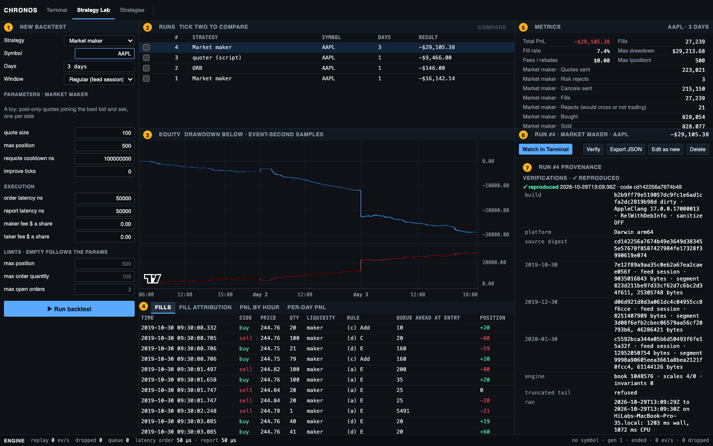
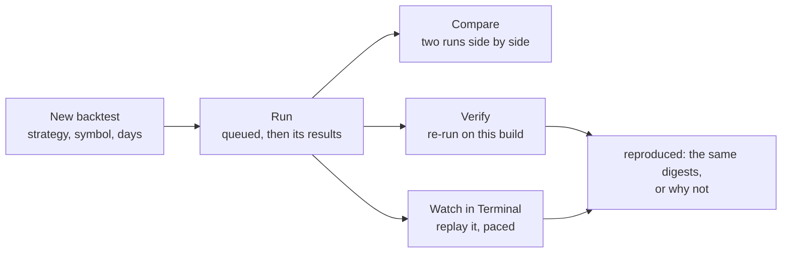
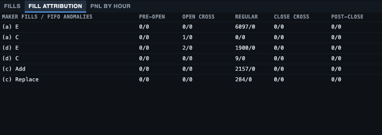
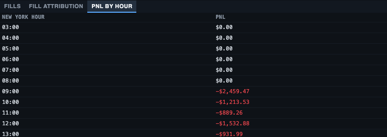
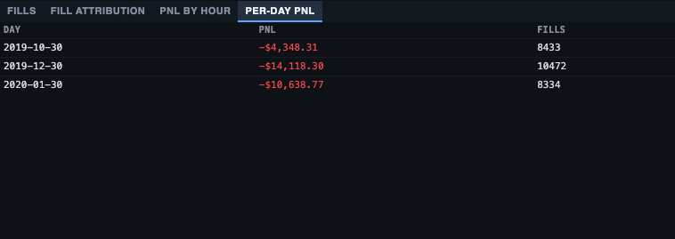
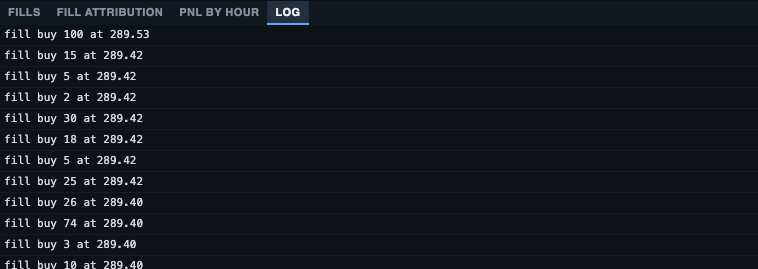
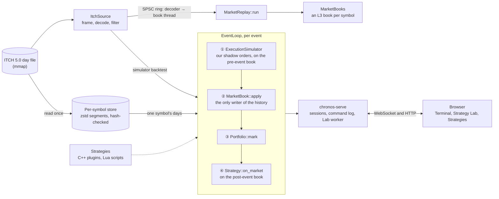

# Chronos

[](https://github.com/JaskaranSingh-01/Chronos/actions/workflows/ci.yml)

Chronos is a deterministic C++20 market simulator for NASDAQ TotalView-ITCH 5.0. It rebuilds the full L3 order book of
every symbol of a trading day in one pass, backtests strategies against that book with exact queue position, and serves
an interactive Trading Terminal, a Strategy Lab and a strategy editor in the browser. Simulated orders never change the
replayed history, and the same input always gives the same books, fills and PnL, byte for byte.


**Contents:** [The evidence](#the-evidence) · [What it does](#what-it-does) · [Setup](#setup) ·
[Running it](#running-it) · [Using it](#using-it) · [How it fits together](#how-it-fits-together) ·
[Design decisions](#design-decisions) · [Documentation](#documentation)

## The evidence

NASDAQ's public sample day, 2019-12-30: 8.25 GB, 268,744,780 messages, 8,906 symbols.

| | |
|---|---|
| **Throughput** | **4,885,679 events/s**: the full day, every symbol, 264,469,515 events in 54 s on an Apple M4, a decoder thread beside the book thread. That is 22 % more than this project's first, allocating engine (commit `b6f3517`), run interleaved with it, for 65 % more CPU; on one thread the engine does 3,385,625, 15 % below it, the cost of its preallocated pools ([the numbers](docs/performance.md#the-numbers)) |
| **Correctness** | 0 rejected events; every book empty after the last message; 258,271 periodic invariant checks, each of the book the event changed, then of all 8,906 books at the end |
| **Determinism** | the same counts and combined digest, `6897f945bcef75c2`, from list and ladder books, one thread and two, and the first engine (the books are empty at the close, so it fingerprints each symbol's adds and replaces); on the day's first 256 MiB, whose books are still live at its end, the same book digests from the Linux/g++ Docker image as from the macOS/clang build |
| **Allocations** | 0 in the replay, counted by a replacement `operator new`, with the heap unchanged; CI checks the hot path |
| **Per-event cost** | 204.7 ns mean; 191 / 447 / 863 ns at p50 / p99 / p99.9 of 1,024-event batch means (the book thread; the clock cannot time one event: see [performance](docs/performance.md#method)) |
| **Tests** | 723 ctest tests (GoogleTest cases and the CLI's process tests; 6 skip, 5 of them for want of the day file), 126 Vitest, 14 Playwright end-to-end; CI on Linux (ASan, UBSan, TSan) and macOS (UBSan) |


[docs/performance.md](docs/performance.md) has the method and every configuration's numbers, and
[bench/RESULTS.md](bench/RESULTS.md) the record of every run.

## What it does

- **Decodes ITCH 5.0** into one 48-byte event type that every source shares, reading only the selected symbols'
  messages. A per-symbol store (zstd segments, hash-checked) lets one symbol's day load in under a second.
- **Rebuilds the L3 book**: every order, in FIFO order, at every price. Price levels live in preallocated pools behind
  open-addressing indices, as a list or as a ladder of slots a cent apart around the best; nothing allocates during a
  replay.
- **Decodes and applies on two threads**, through a lock-free single-producer single-consumer ring, with the same books
  as one thread.
- **Backtests** through one deterministic event loop: constant order and report latencies, a fill model that tracks each
  simulated order's queue position among the historical orders and fills it by four explicit rules with a trade-price
  guard, a portfolio with pre-trade risk limits and maker/taker fees.
- **Takes strategies as plugins**: a strategy is one file in [`strategies/`](strategies/) that registers itself, and the
  CLI, the server and the Lab's form pick it up with no other change ([docs/strategies.md](docs/strategies.md)). Four
  ship: a market maker, an imbalance taker, an opening range breakout and the guide's example.
- **Or writes them in the browser**: the Strategies page edits Lua scripts that run in a sandbox (no clock or files,
  bounded instructions and memory, fixed seeds), checks each on save, and offers it in the Lab. A run keeps the source
  it ran, so it verifies and replays in the terminal to the same digests; a Lua port of the imbalance taker makes the
  C++ plugin's exact fills on SPY's full day.
- **Serves the Trading Terminal**: replay any symbol at 1× to Max, step, seek, across several days; a TradingView-style
  chart, the L3 book with your queue position, and an order ticket that trades against the historical queue.
- **Serves the Strategy Lab**: run backtests from the browser, compare runs, verify a run against its recorded digests,
  and watch it replay in the terminal to a reproduced-or-not verdict.

## Setup

Chronos runs on macOS and Linux. Pick one of two paths:

| | Docker | From source |
|---|---|---|
| **Gives you** | the UI, the server and the CLI in one image | the CLI, the server, the UI, the tests and the benchmarks |
| **Needs** | Docker with Compose v2 | CMake 3.20+; a C++20 compiler (tested with GCC 13, Clang 18 and Apple clang 17); Node 24 with npm, for the UI; git and curl |
| **Disk, with one real day** | about 11 GB: the 8.25 GB day and its 2.8 GB store | the same, plus under 1 GB for the build |

### With Docker

1. Get the code: `git clone https://github.com/JaskaranSingh-01/Chronos.git && cd Chronos`.
2. Optionally put a real day in `data/itch` ([below](#get-a-trading-day)). Without one, the image generates two small
   sample days (ACME and ZETA) and serves those, so the UI opens at once.
3. Run `docker compose up`. The first run builds the image, a few minutes, and reads each day into the per-symbol
   store, a few minutes for a real day, before the server listens.
4. Open <http://localhost:8080/> and enter the token `chronos`.

Ctrl+C or `docker compose down` stops it; the store, the Lab's runs and your scripts stay in the `chronos-state` volume
(`docker compose down -v` deletes them). After pulling new code, `docker compose up --build` rebuilds the image.

### From source

```bash
# macOS: xcode-select --install && brew install cmake, and Node 24 from nodejs.org or nvm
# Ubuntu: sudo apt-get install -y build-essential cmake git curl, and Node 24 from nodejs.org or nvm
git clone https://github.com/JaskaranSingh-01/Chronos.git && cd Chronos
cmake -S . -B build                    # RelWithDebInfo; the first configure fetches the pinned dependencies
cmake --build build -j                 # simulator, chronos-serve and the tests
ctest --test-dir build                 # 723 tests; 6 skip without a day file
(cd web && npm ci && npm run build)    # the UI, into web/dist, which chronos-serve serves
```

### Get a trading day

NASDAQ publishes sample days of TotalView-ITCH 5.0; every number in these docs is from 2019-12-30:

```bash
mkdir -p data/itch
curl -fL 'https://emi.nasdaq.com/ITCH/Nasdaq%20ITCH/12302019.NASDAQ_ITCH50.gz' | gunzip > data/itch/12302019.NASDAQ_ITCH50.bin
```

Any day from that directory works, named `MMDDYYYY.NASDAQ_ITCH50.bin`. `data/` is in `.gitignore`: market data is never
committed. [docs/getting-started.md](docs/getting-started.md) also cuts a 256 MiB slice for quick tests.

## Running it

**The UI.** Start the server on the directory of days, then open the address it prints:

```bash
./build/chronos-serve --data data/itch          # then open http://127.0.0.1:8080/
```

The first start reads each new day into the per-symbol store, about a minute a day; later starts reuse it. `--date`
picks the starting day (the latest by default) and `--port` the port; `--help` lists every option
([docs/cli.md](docs/cli.md#chronos-serve)).

**The CLI.**

```bash
# every symbol's book over the whole day, with the combined digest: about a minute
./build/simulator replay data/itch/12302019.NASDAQ_ITCH50.bin --all --date 2019-12-30

# a backtest from the day file
./build/simulator backtest data/itch/12302019.NASDAQ_ITCH50.bin --symbol SPY --date 2019-12-30 --strategy market_maker

# the same from the store chronos-serve built: one symbol's day reads in under a second
./build/simulator backtest --store data/itch/store --symbol AAPL --date 2019-12-30 --strategy orb --param range_minutes=30

./build/simulator --help                        # every option, and every strategy with its params
```

## Using it

The UI has three pages, switched at the top left: the **Trading Terminal** (`/`), the **Strategy Lab** (`#lab`) and
**Strategies** (`#strategies`). The first browser tab to connect controls the session; any other watches it read-only.
[docs/ui.md](docs/ui.md) describes every panel in full.

### The Trading Terminal: replay a day and trade against it


1. **Pages**: the Terminal, the Strategy Lab and Strategies.
2. **Symbol and days**: type a ticker (the box suggests as you type) and press Enter, or **Load**. Tick several days to
   replay them in a row.
3. **Restart, Play or Pause, Step**: Step applies one event. While paused, an order you place reaches the book on the
   next Step or Play.
4. **Speed**: 1×, 10×, 100× or Max.
5. **The exchange clock and Seek**: jump to a New York time, or to the 09:30 open.
6. **Depth ladder**: the L3 book a cent a row. **MY BID** and **MY ASK** show your resting shares over the shares still
   ahead of you in the queue. Click a row to price the ticket.
7. **Chart**: candles from the market's trades at 1 s to 1 h, VWAP, EMA 20 and volume; your fills as arrows, your orders
   and the shares ahead of each as price lines.
8. **Time and sales**: the market's trades, coloured by the aggressor.
9. **Order ticket**: buy or sell, post-only, IOC or market, the price and quantity; it shows the notional, the fee and
   the position after, then **Place**.
10. **Account**: cash, position, realised and unrealised PnL, fees and max drawdown.
11. **Positions and PnL**: the position, its marks and PnL, with the net PnL over time below.
12. **Open orders, Fills, Queue**: cancel an order; see the fill-model rule behind each fill and the queue ahead at
    entry; follow each resting order's place.
13. **Engine strip**: events a second, skipped snapshots, the simulated latencies and the session's state.

**Try it:** load `AAPL`, press **Open 09:30**, click the best bid in the ladder and press **Place buy 100 @ …**. Press
**Step** and the order joins the back of the queue, the shares ahead of it under **MY BID**; press **▶ Play** at 10×
and watch them shrink until it fills, its rule in **Fills**. Your fills never remove historical liquidity.

### The Strategy Lab: backtest, compare and verify



1. **New backtest**: the strategy (the plugins and your scripts), the symbol, the days (tick several for one run over
   them), the window (**Regular**, each day's session, or **Full day**), the strategy's params, latencies, fees and
   limits. Then **▶ Run backtest**.
2. **Runs**: every run with its state, progress or PnL. Click one to open it; tick two and press **Compare**.
3. **Equity**: the PnL at every second with a market event, its drawdown below.
4. **Results tabs**: **Fills** (each with its rule and the queue ahead at entry), **Fill attribution**, **PnL by
   hour**, **Per-day PnL** (over several days) and **Log** (a script's log lines).
5. **Metrics**: total PnL, fills, fill rate, max drawdown, fees, max |position|, then the strategy's own stats.
6. **The run**: **Watch in Terminal** replays it, paced, to a verdict; **Verify** re-runs it and compares every digest;
   **Export JSON**; **Edit as new** copies its settings into the form; **Delete** asks to confirm.
7. **Provenance**: the build, each day's file and segment hash, the digests, and every verification.



The results tabs, on AAPL:

<table>
  <tr>
    <td width="50%"><br><b>Fill attribution</b>: maker fills and FIFO anomalies by rule and session phase</td>
    <td width="50%"><br><b>PnL by hour</b>, New York time</td>
  </tr>
  <tr>
    <td><br><b>Per-day PnL</b> of a run over several days</td>
    <td><br><b>Log</b>: what a script logged</td>
  </tr>
</table>

Two runs compared: the PnL overlaid, the stats side by side, every setting that differs marked.


### Strategies: write one in the browser


1. **Strategies**: your scripts, each marked ok or error. Type a name and press **New** for a template that runs.
2. **Editor**: the Lua script. **Save** (or Cmd/Ctrl+S) keeps it and loads it at once; **Delete** asks twice.
3. **The check**: its params and limits, or its error and the line.
4. **Guidelines**: what to know before you write or test a strategy.
5. **What a script can call**: the book, orders, timers, the portfolio, stats and the log.

Then pick it in the Strategy Lab as "*name* (script)", set its params, and run it. A run keeps the source it ran, so
editing the script later never changes a saved run. [docs/strategies.md](docs/strategies.md) has the rules, the full
API and the sandbox, and how to write a strategy as a C++ plugin instead.

## How it fits together



[docs/architecture/](docs/architecture/README.md) is the design: the components and threads, the event and execution
model, the invariants, the decisions, and what is still open. [docs/code-map.md](docs/code-map.md) maps it to the code
and lists the eight steps to read first.

## Design decisions

- **History and simulation never mix.** The historical book has one mutator, and our orders are shadow orders that
  never enter it. A backtest therefore leaves the same book digest as a plain replay, which the tests assert.
- **One loop, no wall clock.** Market events and our own events merge in (timestamp, class, sequence) order, and a tie
  goes to the market, so an order never jumps ahead of history stamped at the same nanosecond.
- **A conservative fill model.** A resting order joins the back of the visible queue at its price and fills only by
  rules a real queue would: shares ahead executed or cancelled, a trade behind or through it, a crossing order. Prices
  must be whole cents at $1 or more, as Reg NMS Rule 612 requires, so no order jumps a queue by a fraction of a cent.
  A FIFO-anomaly counter checks the model against real days, and once found a real bug in it.
- **Allocation-free by construction.** Capacity is a run parameter: pools and indices are reserved up front, and a full
  one stops the run cleanly instead of growing mid-replay.
- **Measured, not assumed.** Optimisations follow the profile, and the defaults follow a benchmark run interleaved with
  the first engine on the same machine: one candidate was rejected, and the ladder's slots were widened from price
  units to cents once review showed its $0.0256 window held about one level a side.
- **Reproducible from the browser.** Every session's commands are logged with the build and each input segment's hash,
  and a Lab run can be verified or watched again to the same digests, every fill compared in order, or is reported as
  run on different code or changed input.

## Documentation

| | |
|---|---|
| [Getting started](docs/getting-started.md) | Docker, the native build, the data, first runs |
| [Architecture](docs/architecture/README.md) | the design: purpose and roadmap, components, events and execution, the server, performance and determinism, decisions, acceptance criteria, invariants, open questions |
| [Code map](docs/code-map.md) | each component in the code, where each invariant is enforced, the layout, where to start reading |
| [Market data](docs/market-data.md) | the event contract, ITCH 5.0, the per-symbol store |
| [Order book](docs/order-book.md) | the L3 book, allocation-free storage, the list and the ladder, invariants, digests |
| [Backtesting](docs/backtesting.md) | the event loop, the fill model, risk and fees, the strategies |
| [Writing a strategy](docs/strategies.md) | as a C++ plugin or a Lua script in the browser: the rules, the template, the API, the sandbox, testing |
| [Performance](docs/performance.md) | the numbers, the profile, the method |
| [Server](docs/server.md) | sessions, the command log, the Strategy Lab, the HTTP and WebSocket protocol, security |
| [UI](docs/ui.md) | the Trading Terminal, the Strategy Lab and the Strategies page, and how the page stays at 60 frames a second |
| [CLI](docs/cli.md) | every option, exit codes, `--json` |
| [Testing](docs/testing.md) | the suites, how correctness is checked, sanitizers, CI |
| [Limitations and roadmap](docs/limitations.md) | what the model assumes, and what comes next |

## Status

The engine, the backtester, the per-symbol store, the strategy plugins and scripts, the server and the three UI pages
(Terminal, Strategy Lab, Strategies) are complete and tested; CI runs on every push. The model's assumptions (no market
impact, constant latencies, toy strategies, per-share fees only) and the roadmap (faster level placement, regulatory
sell fees, a LOBSTER adapter) are in [docs/limitations.md](docs/limitations.md).
