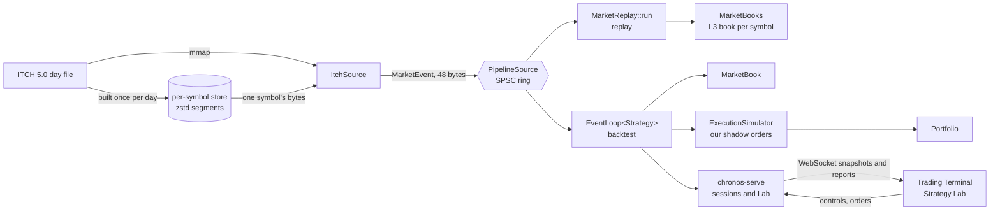

# Architecture

Chronos has three parts, each usable without the next:

1. **The engine** (`include/simulator/`, `src/`, `app/`): a C++20 library and the `simulator` CLI. It decodes NASDAQ
   TotalView-ITCH 5.0, rebuilds the L3 order book of one, several or every symbol, and backtests a strategy against
   that book with exact queue position. It needs only the C++ standard library and POSIX at run time.
2. **The server** (`server/`): `chronos-serve`, an HTTP and WebSocket server on Crow. It replays a symbol
   interactively, takes orders from the browser, runs Strategy Lab backtests on a worker thread, and keeps a
   per-symbol store of the days it serves.
3. **The UI** (`web/`): a React and TypeScript single-page app, the Trading Terminal and the Strategy Lab.

`scripts/check-isolation.sh`, run in CI, enforces the direction: the engine never includes server or web code, and
`simulator_lib` links only the standard library.

## Data flow



Inside the engine, per market event:

```text
ITCH 5.0 file ─► MappedFile ─► ItchSource ── R messages ──► InstrumentRegistry (SymbolId → scales)
                  (mmap)        locate filter, then decode A F U X D E C P
                                       │ MarketEvent (48 bytes) through MarketEventSource::next()
                                       │ (CsvSource and VectorSource implement it too)
            ┌──────────────────────────┴──────────────────────────┐
            ▼ replay                                              ▼ backtest
    MarketReplay::run                              EventLoop<Strategy>, per market event e:
            │                                        ① ExecutionSimulator::on_market(e)   pre-event
            ▼                                        ② MarketBook::apply(e)   the only writer
    MarketBooks: a MarketBook per symbol             ③ Portfolio::mark
    on one shared BookStorage (the history)          ④ Strategy::on_market(e)             post-event
                                                   our orders, through SimQueue:
                                                     Strategy ─► OrderGateway ─► ExecutionSimulator
                                                     ExecutionSimulator ─► Portfolio, Strategy
```

## The guarantees, and where each is enforced

| Guarantee | How | Checked by |
|---|---|---|
| History and simulation never mix (D1) | `MarketBook::apply` is the book's only mutator; strategies, the simulator and the portfolio get `const` references; our orders are shadow orders in `ExecutionSimulator` | `BacktestDeterminismTest`: a backtest leaves the history digest of a plain replay |
| One deterministic loop (D3) | `EventLoop` merges the market stream with our own events in (timestamp, stream, sequence) order; it never reads a wall clock | two identical backtests, byte for byte; the Lab's Verify and Watch re-run a saved run to the same digests, every fill compared in order |
| A conservative fill model (D2) | queue position from the L3 book, four fill rules and a trade-price guard | hand-worked examples in the tests; the FIFO-anomaly counter on real days |
| Every event of a real day applies | the decoder and book reject anything inconsistent, with a reason | the full day, every symbol: 264,469,515 events, 0 rejections |
| No allocation on the replay path | pools, open-addressing indices and the SPSC ring are sized before the replay | a counting `operator new` (0 in the full day) and `scripts/check-hot-path.sh` in CI |
| One thread and two give the same books | the decoder thread only decodes; the book thread applies in order | the full-day log of `--threads 2` equals `--threads 1`'s |

[backtesting.md](backtesting.md) explains D1-D3 in full.

## Threads

| Thread | Does | Talks to |
|---|---|---|
| CLI, `--threads 1` | decodes and applies | — |
| CLI, `--threads 2`: decoder | `ItchSource::next`, locate mapping, instrument registration | the book thread, through `SpscRing<PipelineItem>` (65,536 slots) |
| CLI, `--threads 2`: book | `MarketReplay::run`: routes and applies each event | the decoder, through the ring; end and errors travel outside the ring |
| `chronos-serve`: Crow workers | HTTP and WebSocket I/O, schema checks | the session's inbox; they read published snapshots |
| `chronos-serve`: session runner | one `ReplaySession`: its `EventLoop`, the replay clock, commands in order | the inbox (bounded FIFO), the latest-value snapshot slot, the report ring |
| `chronos-serve`: command-log writer | appends each command to `sessions/<id>.jsonl` | a bounded queue: a push never waits; after a full queue or a failed write, the session refuses commands (`log_unavailable`), so none goes unlogged |
| `chronos-serve`: Lab worker | one backtest or verification at a time | the job queue (8 waiting); results are saved to `runs/<id>.json` |

The engine never reads a clock. In a session, the runner alone reads one, to pace the replay; the Lab times its runs
for their provenance, outside the loop.

## Repository layout

| Path | Contents |
|---|---|
| `include/simulator/types/` | `Price`, `Quantity` (`uint64`), `Timestamp` (ns since the Unix epoch, UTC), `OrderId`, `SymbolId` (`uint32`), `Side` |
| `include/simulator/orders/` | `Order`, `PriceLevel`, `OrderBook` (a list or a ladder of levels), `OrderIndex` and `LevelIndex` (open addressing), `OrderPool`, `LevelPool`, and `BookStorage`, which reserves them all up front |
| `include/simulator/market/` | `MarketEvent`, `InstrumentRegistry`, `MarketEventSource`, `VectorSource`, `MarketBook`, `MarketBooks`, `MarketReplay`, `Trade`, and `SpscRing` and `PipelineSource` |
| `include/simulator/io/` | `MappedFile` |
| `include/simulator/itch/` | `ItchSource` with its framing (`ItchMessageReader`, `ByteReader`) and `ItchDecoder` |
| `include/simulator/csv/` | `CsvSource`, a CSV event source for the library and tests |
| `include/simulator/store/` | the per-symbol store's index and segment reader |
| `include/simulator/sim/` | `SimEvent` and `SimQueue`, `OrderGateway`, `ExecutionReport`, `ExecutionSimulator` |
| `include/simulator/portfolio/` | `Portfolio`, `RiskLimits`, `FeeSchedule` |
| `include/simulator/engine/` | `EventLoop<S>`, the `Strategy` concept, `StrategyContext`, `NullStrategy` |
| `include/simulator/strategies/` | `ImbalanceTaker`, `MarketMaker` and `Orb` (opening range breakout) |
| `include/simulator/metrics/` | `LatencyHistogram` |
| `include/simulator/cli/` | argument parsing and the usage text |
| `src/` | the implementations, mirroring `include/simulator/` |
| `app/` | `main.cpp`, and `alloc_counter.cpp`, a counting `operator new` linked only into executables |
| `server/` | `chronos-serve`: sessions, the protocol, the command log, the Lab, the store's builder |
| `web/` | the Trading Terminal and the Strategy Lab; Vitest unit tests and Playwright end-to-end tests |
| `bench/` | `simulator_bench.cpp`, `run.sh`, `summary.py`, [`RESULTS.md`](../bench/RESULTS.md) and `results/` |
| `tests/` | one suite per component; `tests/support/` holds the source conformance suite; `tests/itch/` a byte-exact ITCH builder checked against real NASDAQ bytes |
| `scripts/` | the format, isolation and hot-path checks CI runs, and the Docker entrypoint |

## Where to start reading

For a review, in this order:

1. [`include/simulator/market/market_event.hpp`](../include/simulator/market/market_event.hpp): the one event type
   every source emits.
2. [`include/simulator/market/market_book.hpp`](../include/simulator/market/market_book.hpp) and
   [`src/market/market_book.cpp`](../src/market/market_book.cpp): the L3 book, its invariants and digest.
3. [`include/simulator/orders/order_book.hpp`](../include/simulator/orders/order_book.hpp) and
   [`src/orders/order_book.cpp`](../src/orders/order_book.cpp): price levels as a list or a ladder a cent apart.
4. [`include/simulator/orders/book_storage.hpp`](../include/simulator/orders/book_storage.hpp): the pools and
   open-addressing indices that make the replay allocation-free.
5. [`include/simulator/market/spsc_ring.hpp`](../include/simulator/market/spsc_ring.hpp) and
   [`pipeline_source.hpp`](../include/simulator/market/pipeline_source.hpp): the two-thread pipeline.
6. [`include/simulator/engine/event_loop.hpp`](../include/simulator/engine/event_loop.hpp): the deterministic loop.
7. [`include/simulator/sim/execution_simulator.hpp`](../include/simulator/sim/execution_simulator.hpp) and its
   `.cpp`: the fill model.
8. [`include/simulator/strategies/orb.hpp`](../include/simulator/strategies/orb.hpp): a complete strategy against
   the `Strategy` concept.
