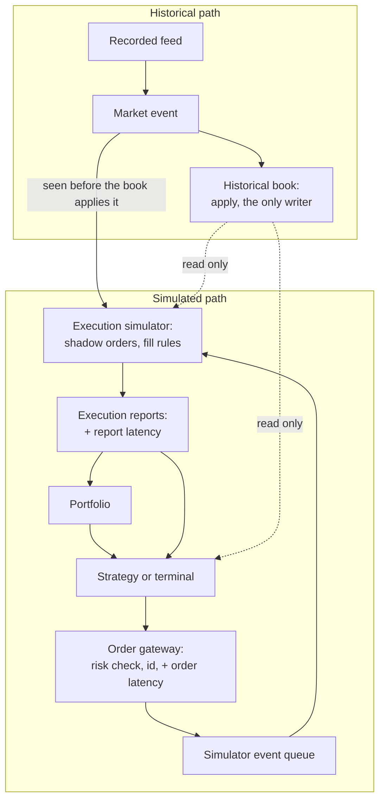
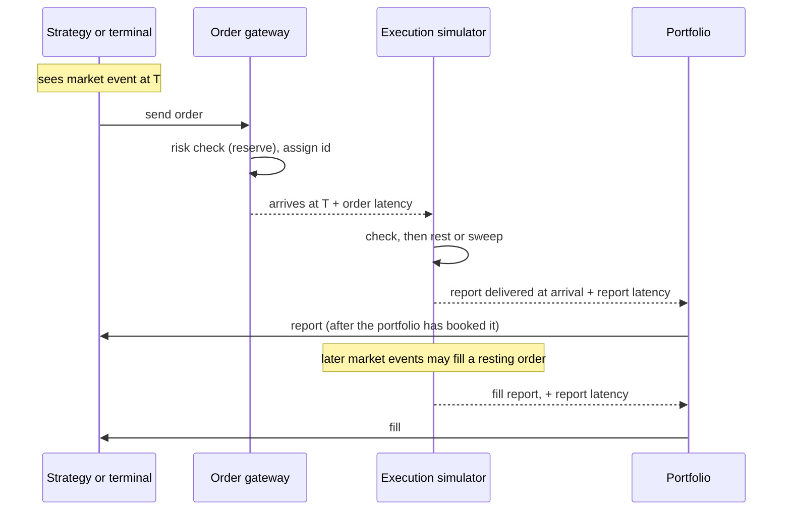

# Events and execution

Two kinds of things happen in a Chronos run, and they follow different paths:

- **Historical market events** say what happened in the real market. They rebuild the historical book, and nothing
  else changes it.
- **Simulated orders** are what a strategy, or a person at the terminal, would have sent. They wait in the historical
  queue as shadows and are filled by explicit rules. They never enter the historical book.

> **The architectural invariant ([I3](README.md#the-invariants), [I4](README.md#the-invariants)).** Historical
> exchange events reconstruct the historical market. They are never treated as new orders submitted to a matching
> engine. A historical add records that an order rested; it is never matched, even when it locks or crosses the book.
> Historical executions, cancellations, deletions and replacements are applied to the order they name, with their
> exchange meaning. Chronos has no matching engine for historical orders, and simulated orders never change history.

The only link from history to simulation is that the simulator **observes** each market event, and both it and the
strategy **read** the book. No arrow runs from the simulated path into the book.

## The historical path

### What each event does to the book

| Event | Effect on the book | Rejected (book unchanged) when |
|---|---|---|
| **Add** | a new order rests at its price, at the back of that price's queue | its id is already live; zero quantity |
| **Execute** | the order's remaining quantity falls by the executed quantity; at zero it leaves the book. A partial execution keeps the order's place in the queue | unknown id; zero quantity; more than the remaining |
| **Cancel** | the remaining quantity falls; the order keeps its place | unknown id; zero quantity; more than the remaining |
| **Delete** | the order leaves the book | unknown id |
| **Replace** | the old order leaves the book; a new one, with a new id, price and quantity on the same side, rests at the back of its price's queue | unknown old id; the new id is live or equals the old one; zero quantity |
| **Trade** | none: a print against hidden liquidity | — |
| **Status** | the book's trading state changes; a book that is not trading may be crossed | — |
| **Clear** | every order leaves the book (between days) | — |
| **Modify** | none | always (unsupported; no source emits it) |

Any event naming a symbol other than the book's is rejected too. An Add or Replace that finds no room also leaves the
book unchanged, but it is a fatal failure, not a rejection: the run stops (`CapacityExhausted`). Every order carries an
arrival sequence number, so its place among the orders at its price is exact. That queue is what the simulated path
reads.

### The trade an event prints

Before the book applies an event, the engine reads the trade it prints, if any: an Execute prints at the resting
order's price, or at its own price when the message carries one; a Trade prints as given. The aggressor is the side
opposite the resting order. These prints, and only these, feed the candles, the tape and the trade a strategy sees.
Simulated fills are never market trades ([glossary.md](glossary.md#trade)).

### Invalid events, errors and the end

- **An event that does not fit the book** is rejected with a reason and counted; the run continues. The strategy is
  not called for it, and the execution simulator, which checks the same conditions, ignores it.
- **A fatal failure** stops the run: a reader error, a time earlier than the previous event's, exhausted capacity, or a
  broken invariant when checking is on. The result is marked partial, with the cause and position.
- **The end of the stream**, after a clean end: timers stop, and the simulator events still queued run against the
  final book (at most 100,000). After a fatal failure they are discarded instead.

## The simulated path

### An order's lifecycle

1. **Send.** The gateway checks the order against the risk limits before anything else: no larger than the largest
   order allowed, no more open orders than allowed, and a worst-case position (every open order on its side filled,
   this one included) within the position limit. A refused order never leaves the gateway. An accepted one gets the
   gateway's next id (1, 2, 3, ... in each run) and is scheduled to arrive one **order latency** later. A simulated id
   is looked up only among simulated orders, never in the historical book, so one equal to a historical order's id is
   harmless.
2. **Arrive.** The simulator checks the order against the book as it is at arrival:

   | Check | Rejected as |
   |---|---|
   | zero quantity | invalid order |
   | a price off the grid (a whole cent at $1 or more; one tick below $1) | off tick, so no order can jump a queue by a fraction of a cent |
   | the book is not trading | not trading |
   | a day (post-only) order that would take liquidity | would cross |

3. **Rest or sweep.**
   - A **day order** is post-only. It rests as a shadow at its price, behind every historical order already there:
     its **ahead quantity** is the visible quantity at that price. Historical orders that join the price later queue
     behind it; orders at better prices are ahead of it by price, as on the exchange. Our own resting orders keep
     their priority among themselves.
   - An **IOC order** walks the visible opposite levels, best first, while they cross its price, filling the smaller
     of what remains and each level's quantity at that level's price, as taker. Whatever is left expires. These fills
     remove nothing from the book ([no market impact](#what-the-model-leaves-out)).
   - A **market order** (terminal only) is an IOC priced 1 % beyond the best opposite price, the band rounded down to
     the price grid; with no opposite price it is refused (`no_liquidity`).
4. **Report.** Each outcome is an execution report: accepted, rejected (with a reason), fill (price, quantity,
   maker or taker, the rule that filled it, and the ahead quantity when it rested), cancelled, cancel rejected (too
   late) or expired. A report is delivered one **report latency** after it happened.
5. **Book.** At delivery the portfolio books the report first, then the strategy sees it.
6. **Cancel.** A cancel also travels one order latency. If the order still rests when it arrives, it is cancelled;
   if it has filled or expired by then, the cancel is rejected.

### The fill rules

On every market event, **before** the book applies it, the simulator checks each resting shadow order `o` (on the
book as it was before the event, because the rules need the historical order the event names):

| Rule | Event | Effect on `o` |
|---|---|---|
| **(b)** | an execute, cancel, delete or replace of a historical order **ahead** of `o` at `o`'s price | `o`'s ahead quantity shrinks by the quantity removed |
| **(a)** | an execute of a historical order **behind** `o` at `o`'s price | `o` fills at its price: a trade behind us means we would have traded first |
| **(d)** | an execute of a same-side historical order at a **worse** price than `o` | `o` fills at its price: a trade-through would have reached us first |
| **(c)** | an add, or a replace's new order, on the **opposite** side at or through `o`'s price | `o` fills at its price |

- **Trade-price guard.** Rules (a) and (d) fill only if the trade's price is not better than `o`'s. An execution that
  carries its own price (a price-slid order executed a tick better than it was displayed) can be better; then the
  aggressor never reached our price, and we do not fill.
- **Allocation.** One event fills our orders in our priority order (best price, then arrival), and the total is
  capped at the event's quantity. Every such fill is maker liquidity.
- **Not trading.** While the book is halted, paused or quoting only, no historical event fills a shadow order; rule
  (b) still runs, as queues still move.
- **The FIFO-anomaly check.** A fill by rule (a) or (d) while `o` still has quantity ahead contradicts a FIFO queue.
  Each is counted, and the first ten are kept with their context. The counter found a real defect: before the
  trade-price guard, a full-day SPY market-maker run had 583 anomalies among 13,539 maker fills, all from
  price-slid executions; with the guard, the same run (at `a5ed53b`, 2026-10-13) had none.

**What is conservative, and what is not ([Q1](README.md#open-questions-and-known-gaps)).** Queue position is
conservative: an order joins behind every order already at its price, and a tie in time goes to the market. Rules
(a), (b) and (d) follow from a FIFO queue. Rule (c) is an assumption: it treats a historical order that posted at or
through our price as one that would have traded with us, although it posted passively where our order did not exist,
and might instead have been repriced or rejected (a post-only order, say). In the published SPY market-maker run on the
first 256 MiB of the 2019-12-30 day file, rule (c) produced 106 of the 143 fills. No measurement yet shows fills and
PnL with the rule turned off.

### Ordering and time

Everything is ordered by (timestamp, class, sequence) ([I5](README.md#the-invariants)):

| Class | What | Sequence |
|---|---|---|
| 0 | market event | source order |
| 1 | simulator event: order arrival, cancel arrival, report delivery, timer | insertion order |
| 2 | manual command (interactive sessions only) | command order; after a Step that stops inside a timestamp, a batch applies before the rest of that timestamp's market events, and only its own simulator events wait for them |

- At an equal time the market goes first, so an order arriving at `T` queues behind every historical add stamped `T`.
- Simulator events at exactly a market event's time `T`, including zero-latency events that event creates, run after
  **every** market event at `T`, since several feed messages can share a nanosecond.
- Per market event, in this order: the simulator observes it on the pre-event book; the trade it prints is read; the
  book applies it; the portfolio marks its position (if one is open); the strategy is called, on the post-event book,
  only if the book applied the event.
- An order sent in reaction to an event therefore arrives after it ([I6](README.md#the-invariants)): no look-ahead.

### Day boundaries

A run in the server covers one or more days (up to 32, in date order, not necessarily consecutive). Between two days
the stream carries a Clear. Every resting shadow order expires, as a day order does, and the book empties. The position
and cash carry over; the opening range breakout closes a carried position at the start of the next day. An order still
in flight at the Clear arrives on the new day and may rest there ([Q11](README.md#open-questions-and-known-gaps)).

## The portfolio

- Reports are booked at delivery, a report latency after they happened.
- Position and cash change with each fill; fees are per share, maker and taker apart, and a negative fee is a rebate.
- A long position is marked at the best bid and a short at the best ask. PnL is realised plus unrealised minus fees;
  drawdown is tracked from the peak.
- Money is integer ([market-data-and-replay.md](market-data-and-replay.md#prices-quantities-and-money)).
- A digest covers every fill booked, in order (time, order, side, price, quantity, liquidity), then the totals, so a
  run reproduces fill by fill, not only in its sums.

## Strategies

A strategy is called on three occasions: an applied market event, a report delivered to it, and a timer it set. Each
call gets a read-only book and portfolio, the order gateway, and the trade the event printed, if any. A strategy is
given no way to reach the book's writer, the simulator's state or a wall clock; the only time it is given is exchange
time. A script's sandbox enforces this; a C++ plugin keeps it as a rule, which `StrategyRegistryTest`'s repeated runs
check only in effect. In an interactive session the same boundary holds an attached strategy (a registered one, or a
script with its source), or none; manual orders use the same gateway instead
([web-terminal.md](web-terminal.md#strategies-and-manual-orders-in-a-session)).

## What the model leaves out

These are deliberate and documented in [limitations.md](../limitations.md):

- **No market impact.** A simulated fill removes nothing, so repeated IOCs can take the same visible shares again;
  aggressive fill rates are optimistic.
- **Hidden liquidity never fills a shadow order.** Trades against hidden orders print, but rules (a) to (d) consider
  displayed orders only.
- **No auctions.** Executions in the opening and closing crosses fill shadow orders by the same rules, at our price
  rather than the cross price.
- **Constant latencies.** The order latency also stands in for the market-data delay; there are no distributions
  and no exchange-side queueing.
- **Order types:** IOC and post-only day orders; protected market orders in the terminal. A marketable day order is
  rejected, not partly filled.
- **Fees per share only;** regulatory sell fees are planned.

## Status

| Behaviour | Status | Evidence |
|---|---|---|
| History unchanged by simulation | **Verified** | a backtest's book digest equals a plain replay's, on generated data always and on a real day when present |
| Every event of a real day applies | **Verified** | 0 rejections over the full day of 2019-12-30 |
| The fill rules, the guard, IOC sweeps and the loop order | **Verified** | worked-example tests, one per rule and for the ordering of a tie |
| FIFO consistency of the rules on real data | **Partial** | 0 anomalies over the SPY market maker's full day at `a5ed53b` (2026-10-13); not re-run since the off-grid rule, and no test asserts it |
| Determinism of a backtest | **Verified** | two runs identical; the Lab's Verify and Watch reproduce saved runs digest for digest |
| The realism of rule (c) | **Open** | [Q1](README.md#open-questions-and-known-gaps) |
| Sensitivity to latency | **Open** | latencies are constants; no sweep is recorded |
| An independent check of the book against another source | **Planned** | LOBSTER ([Q2](README.md#open-questions-and-known-gaps)) |
