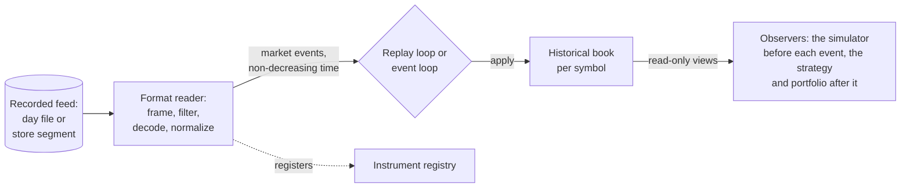

# Market data and replay

How a recorded feed becomes historical market state, and what each stage promises the next. The terms are defined in
[glossary.md](glossary.md); the reference details (the event's fields, the ITCH mapping, the store's layout, download
commands) are in [market-data.md](../market-data.md).

## The pipeline

| Stage | Responsibility | Takes | Gives | Fails by |
|---|---|---|---|---|
| **Recorded feed** | the bytes, unchanged | — | a day file, or one symbol's segment of a day from the store | a store segment that does not read back intact (a named error) |
| **Format reader** | framing, symbol selection, decoding, validation of the wire format, translation into market events, instrument registration, clock conversion | bytes | one market event per call, end of stream, or an error with its position | a sticky error: every later call returns it too |
| **Replay loop / event loop** | ordering checks, routing to the symbol's book, and (in the event loop) the simulation | market events | applied events, results and reports | stopping at a reader error, an out-of-order time, exhausted capacity, or an invariant violation in a checked run |
| **Historical book** | the only change to historical state | one market event | the new state, or a rejection that leaves the state unchanged | rejecting an event that does not fit, with a reason |
| **Observers** | the execution simulator (before the event) and the strategy and portfolio (after it) | a read-only book | orders and reports, never a change to the book | — |

## Why readers are separate from the replay

A reader knows its format; the replay knows only events. That split means:

- the book and both loops are written and tested once, against one event contract, whatever the input
  ([I1](README.md#the-invariants));
- a new format is one new reader, held to the same conformance suite as the others, with no change downstream
  ([I2](README.md#the-invariants));
- format work (framing, filtering, clock conversion) can be optimised or moved to its own thread without touching
  the book, as the two-thread pipeline does.

The decision and its alternatives are [D4](decisions.md#d4-one-event-contract-and-one-book) and
[D5](decisions.md#d5-format-specific-readers-normalize-at-the-input-boundary).

## The market event

Every reader emits the same fixed-size event. Its meaning:

| Part | Meaning |
|---|---|
| **time** | nanoseconds since the Unix epoch, UTC: the exchange's time of the event |
| **symbol** | a dense id registered in the instrument registry before any event of the symbol is emitted |
| **type** | what happened (below) |
| **order id**, **new order id** | the order the event concerns; a replace's new id |
| **side**, **price**, **quantity** | as the type needs them; price in integer ticks at the symbol's price scale, quantity in integer units at its quantity scale |
| **trading state** | only on a status event |

| Type | Meaning |
|---|---|
| **Add** | an order now rests in the book at its price, behind every order already there |
| **Execute** | some or all of a resting order's quantity traded; it may carry its own execution price |
| **Cancel** | some of a resting order's quantity was withdrawn; the rest keeps its place |
| **Delete** | a resting order left the book |
| **Replace** | a resting order was withdrawn and a new one, with a new id, price and quantity, now rests behind the orders at its price |
| **Trade** | a trade printed against no displayed order (hidden liquidity); it changes no order |
| **Status** | the symbol's trading state changed (trading, halted, paused, quotation only) |
| **Clear** | the book is emptied: emitted between one day of a multi-day run and the next, never by a feed message |
| **Modify** | reserved for a future source; the book rejects it as unsupported |

[event-and-execution-model.md](event-and-execution-model.md) gives each type's effect on the book.

### The source contract

Every source, in every format, promises:

1. Times never go backwards.
2. An execute, cancel, delete or replace names a live order of an earlier add.
3. An executed or cancelled quantity is within the order's remaining quantity.
4. A symbol is registered, with its scales, before its first event.
5. The same bytes give the same events.
6. End of stream and errors are sticky, and an error carries the position where it occurred.

The conformance suite checks these for the ITCH, CSV and in-memory sources (**Verified**; the error check does not
apply to the in-memory source, which cannot fail). The book and
the loops still check what they rely on (items 1 to 3), so a source that breaks the contract is caught, not trusted.

## Time

- **ITCH** times are nanoseconds after midnight. The reader adds the session's midnight, the epoch time of 00:00 on the
  session date in New York, from the date given and the US Eastern offset of that date (daylight-saving rules in force
  since 2007), or an explicit offset. The offset is constant within a trading day.
- **Ordering.** Events are processed in their source order. Equal times are allowed, since several messages can share
  a nanosecond, and keep their source order. A time earlier than the previous event's stops the run.
- **Days.** A server run over several days of one symbol plays them in date order as one stream, with a Clear between
  them.
  Epoch times keep increasing across the night.
- **Session hours.** The server reads each day's regular hours from the feed's own System Events (the start and end of
  market hours), falling back to 09:30-16:00 when a file lacks them. The CLI uses 09:30-16:00 always
  ([Q10](README.md#open-questions-and-known-gaps)).
- **No wall clock.** Market time comes only from events. Wall-clock time exists only in the server, to pace an
  interactive replay ([web-terminal.md](web-terminal.md#exchange-time-and-wall-clock-time)).

## Prices, quantities and money

- A price is an integer count of ticks at the instrument's price scale: ITCH equities use four decimals, so $100.0000
  is 1,000,000. Prices are compared only within one instrument.
- A quantity is an unsigned 64-bit integer at the instrument's quantity scale: 0 (whole shares) for ITCH.
- Money is an integer count of the smallest unit the two scales give (a tick-share, $0.0001, for ITCH), with 128-bit
  products, so no rounding enters PnL.
- No floating point is used for prices, quantities or money in the engine.

## Order ids and symbols

- The event contract promises only that a live order's id is unique within its symbol (ITCH's happen to be unique
  across the whole day), so books index orders by (book, order id).
- A replace retires its old id and introduces a new one; a replace whose new id equals its old one is rejected.
- Symbol ids are dense and assigned in registration order, so per-symbol state can live in arrays.

## How ITCH maps to market events

| ITCH message | Becomes |
|---|---|
| `A`, `F` add order (without and with attribution) | Add |
| `U` replace | Replace |
| `X` cancel (partial) | Cancel |
| `D` delete | Delete |
| `E` executed | Execute, at the resting order's price |
| `C` executed with price | Execute, at the message's own price |
| `P` trade (non-cross) | Trade |
| `H` trading action | Status |
| `R` stock directory | registers the instrument; no event |
| `S` system event | no event of its own; at the start of system hours, a selected symbol that had no trading action in the pre-open spin gets a Status of halted, as the ITCH 5.0 specification says, until its `H` arrives |

Messages of unselected symbols are skipped by their locate field before they are decoded, so a one-symbol replay
decodes only that symbol's messages.

### Messages not translated

Every other message type is skipped without error. Those that matter ([Q6](README.md#open-questions-and-known-gaps)):

| Message | Consequence of skipping it |
|---|---|
| `Q` cross trade | the opening and closing crosses' bulk prints are absent from the candles and the tape |
| `B` broken trade | a broken trade still counts in the candles and the tape |
| `h` operational halt, `W` market-wide circuit breaker | these halts are not seen; trading state comes from `H` only |
| `C`'s printable flag | validated, then dropped: non-printable executions (those in a cross) count in the candles, the tape and the ORB's opening range |
| `I` (NOII), `L`, `V`, `Y`, `J`, `K`, `N` and others | no effect on the book or any figure Chronos reports |

None of these changes the book: crosses execute book orders through `E` and `C` messages, which are translated.

## Validation and failure

Validation is split by what can be checked where:

| Layer | Checks | On failure |
|---|---|---|
| **Reader** | framing (lengths, a cut message), payload sizes per type, side and state bytes, the printable flag, the selected symbol's directory entry, CSV columns and numbers | a sticky source error with its position; the run stops and reports it. A file cut mid-message fails unless the run allows a truncated tail |
| **Loop** | time order | the run stops (`out_of_order_timestamp`) |
| **Book** | the event fits the state: the order exists, the id is new, quantities are positive and within the remaining, the event is the book's symbol | the event is rejected with a reason, the book is unchanged, the rejection is counted, and the run continues |
| **Book storage** | room for a new order or level | the run stops cleanly with the structure named; nothing grows |
| **Invariants** | (when checking is on) the book's structure is consistent | the run stops and names the broken invariant |

A rejected event is evidence, not noise: on a correct decoder and book, a real day has none. It is counted per type
and result so that a decoding error, which typically shows as unknown orders or over-executions, is visible.

## Single-symbol, multi-symbol, multi-day

| Mode | Scope | Status |
|---|---|---|
| Replay | one symbol, a list, or every symbol of a day; one book per symbol over shared storage | **Verified** (every symbol of the full day) |
| CLI backtest | one symbol, one day | **Verified** |
| Session, Lab run | one symbol, one or more days (up to 32, in date order, not necessarily consecutive) | **Implemented** |
| Several venues merged by time | — | **Planned** (a k-way merge of sources by time) |
| Several symbols in one backtest or session | — | **Out of scope** |

## The per-symbol store

Reading one symbol's day from the day file means framing all 8.25 GB of it. The store, built once per day by the
server (about a minute a day), keeps one compressed file per symbol, holding that symbol's segment of each day, so a
one-symbol replay reads about 0.6 % of the day (for AAPL; 17 MB as stored).

Its contract:

- **Equivalence.** A symbol's segment holds every frame of the symbol's locate from its directory entry on, and every
  frame that reaches every symbol (System Events, frames no locate routes, a cut tail), in file order. Replaying the
  segment gives the same events as the day file for that symbol (**Verified**: every symbol of generated days in
  every test run, and every symbol of the full real day, replayed to the same book, when its file is present).
- **Integrity.** Each segment is checked as it is read: its range, each compressed frame's checksum and the
  segment's hash. A damaged segment fails, naming the symbol and day.
- **Identity.** Each day file has a content hash, and each segment its own. A Lab run records the segment hashes it
  read, so a change to one symbol's data invalidates only that symbol's runs.
- **Crash safety.** A build that does not commit is cut back to the last committed state; the index is replaced
  atomically. One server at a time holds the store's lock.

## Requirements for real data

- **Format.** Uncompressed NASDAQ TotalView-ITCH 5.0, one file per day, named `MMDDYYYY.NASDAQ_ITCH50.bin`. The date in
  the name sets the session's midnight. Chronos does not read gzip.
- **Completeness.** A file must hold the stock directory entry of every symbol replayed; one cut mid-message needs the
  truncated-tail option, and ends there.
- **Space.** The store takes about a third of the days it holds; building a day needs free space of at least 60 % of
  its file.
- **Licensing.** Market data is never committed or redistributed with the project.
- **A new format** must provide per-order (L3) events, its own clock conversion and scales, and pass the conformance
  suite. LOBSTER is the planned second real format, with a per-message comparison of the rebuilt book against
  LOBSTER's own book as an independent correctness check.

## Input support

| Format | Status |
|---|---|
| NASDAQ TotalView-ITCH 5.0, day files | **Verified** on NASDAQ's sample day of 2019-12-30 |
| The per-symbol store | **Verified** |
| CSV events | **Verified** in the library and tests; not available in the CLI (an open question) |
| LOBSTER | **Planned** |
| L2 (aggregated) data, other venues | **Out of scope** |
