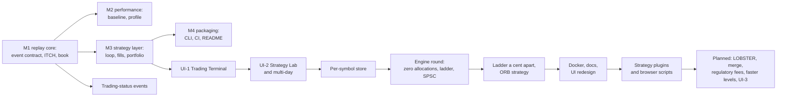

# Project overview and roadmap

## What Chronos is

Chronos is an event-driven historical market simulator in C++20. It reads an exchange's recorded per-order feed
(NASDAQ TotalView-ITCH 5.0), rebuilds the full order book of every symbol message by message, and runs trading
strategies against that rebuilt book. A strategy's orders wait in the real historical queue and are filled by explicit
rules, without the historical market ever being changed by them. Every run is deterministic and can be reproduced and
verified. A local server, `chronos-serve`, puts the same engine behind a browser: the Trading Terminal to replay and
trade by hand, the Strategy Lab to run, compare and verify backtests, and the Strategies page to write strategies as
Lua scripts.

## The problem it addresses

A backtest of an execution-sensitive strategy (a market maker, anything that rests orders) is only as good as its
answer to "would this order have been filled?". Common shortcuts give wrong answers:

- **Filling at the touch.** Treating a resting order as filled once the price trades at its level ignores the orders
  queued ahead of it, and overstates passive fills.
- **Mixing history and simulation.** Letting simulated orders change the replayed book makes every later historical
  event wrong, because history no longer matches what was recorded.
- **Bar or top-of-book data.** Without per-order data, queue position cannot be known at all.
- **Unrepeatable runs.** A result that changes between runs, or cannot be traced to its input and code, cannot be
  trusted or debugged.

Replaying a real per-order feed at full scale is also an engineering problem: a day of NASDAQ is 8.25 GB and 268.7
million messages for 8,906 symbols. Chronos treats throughput, memory behaviour and determinism as requirements, and
measures them.

## Who it is for

| User | Uses Chronos to |
|---|---|
| An engineer reviewing trading-infrastructure work | read a complete, tested system: feed decoding, L3 book reconstruction, an allocation-free hot path, a lock-free pipeline, a deterministic event loop, a reproducible server |
| A strategy researcher | backtest a strategy on one symbol over one or more real days with queue-aware fills, latencies, fees and risk limits, and compare runs |
| Someone studying market microstructure | replay a symbol at any speed, watch the L3 book and the tape, and place orders against the historical queue |

The project's primary purpose is the first: it is a showcase of trading-infrastructure engineering, and the
strategies are deliberately simple ([Scope](#scope-and-non-goals)).

## Use cases

1. **Replay and check a day.** Rebuild the book of one, several or all symbols of a day file, and report events,
   rejections, invariant checks, digests and timing.
2. **Backtest a strategy.** Run a registered strategy over one symbol for one day from the CLI, or a registered strategy
   or one written in the browser over one or more days (up to 32, in date order, not necessarily consecutive) from the
   server, and get fills with the rule that produced each, PnL, drawdown and fill attribution.
3. **Trade by hand.** Replay a symbol in the browser at 1×, 10×, 100× or as fast as possible, pause, step, seek, and
   place post-only, IOC or market orders that join the historical queue.
4. **Run and verify experiments.** Queue backtests from the browser, compare two runs, verify a saved run reproduces
   its recorded digests, and watch it again in the terminal to a reproduced-or-not verdict.
5. **Measure the engine.** Benchmark the replay on the full day, interleaved with a previous build, with a recorded
   method.

## Current implementation and intended system

Chronos is functionally complete for its stated scope. What remains is a set of planned extensions and open
questions, not missing core pieces. The statuses use the words defined in [README.md](README.md#status-words).

| Capability | Status |
|---|---|
| NASDAQ ITCH 5.0 decoding into one normalized event type | **Verified** (full day, 0 rejected events) |
| A generic event contract with a conformance suite; a CSV source for the library and tests | **Verified** |
| L3 book reconstruction for one, several or all symbols | **Verified** |
| Allocation-free replay, a list and a ladder level backend, a two-thread decode/apply pipeline | **Verified** |
| Trading-status (halt) events: halted books may cross; no fills while not trading | **Implemented** |
| A per-symbol store: one symbol's day readable without reading the whole day file | **Verified** (hash-checked on every read) |
| A deterministic event loop with latencies, a queue-position fill model, a portfolio with risk limits and fees | **Verified** (determinism); the fill model's realism is open ([Q1](README.md#open-questions-and-known-gaps)) |
| Strategies as plugins: one file each in `strategies/`, offered by the CLI, the server and the Lab with no other change | **Verified** (every plugin run by `StrategyRegistryTest`; the same fills before and after the move) |
| Four strategies: a market maker, an imbalance taker, an opening range breakout, the plugin guide's example | **Implemented** (toys by design) |
| Strategies written in the browser: Lua scripts in a sandbox, checked on save, run in the Lab and Watch, reproduced from the source each run keeps | **Verified** (a Lua port of the imbalance taker makes the C++ plugin's exact fills; a run verifies after its script is edited) |
| Multi-day runs over several days of one symbol, in the server (the terminal and the Lab); the CLI runs one day | **Implemented** |
| `chronos-serve`: an interactive session, a command log that reproduces it, an HTTP and WebSocket API | **Verified** (reproduction from the log is tested) |
| The Trading Terminal, the Strategy Lab and the Strategies page in the browser | **Verified** (end-to-end tests against a real server) |
| One-command start in Docker | **Implemented** |
| A LOBSTER adapter, with a per-message check of the book against LOBSTER's own | **Planned** |
| A k-way merge of several sources by time, for multi-venue replay | **Planned** |
| The headless replay run through the event loop with a null strategy | **Planned** ([Q5](README.md#open-questions-and-known-gaps)) |
| Regulatory sell fees (SEC Section 31, FINRA TAF) | **Planned** |
| Faster new-level placement (the largest share of the book thread's time) | **Planned** |
| An engine monitor and a symbol browser in the UI (UI-3, not yet specified) | **Partial**: an engine strip shows the event rate, dropped snapshots and the configured latencies; a ranked symbol picker, no browser |
| CSV input in the CLI | **Planned** |

## Non-functional requirements

| Requirement | What it means here | Status and evidence |
|---|---|---|
| **Correctness** | Every event of a real day applies to the book it names; the book's invariants hold; historical and simulated paths stay apart | **Verified** on the full day of 2019-12-30: 0 rejections, invariants checked every 1,024 events; [Q2](README.md#open-questions-and-known-gaps) limits what the digest proves |
| **Determinism** | The same input, configuration, build and commands give the same books, fills and PnL, byte for byte | **Verified**: repeated runs, reproduction from a command log, Lab verification, the same digests on Linux/g++ and macOS/clang |
| **Throughput** | A full day of every symbol replays in about a minute on a laptop-class machine | **Verified**: 4,885,679 events/s on an Apple M4 ([performance-and-determinism.md](performance-and-determinism.md#the-recorded-baseline)) |
| **Latency** | The cost per event is known in distribution, not only on average | **Partial**: percentiles of 1,024-event batch means ([Q8](README.md#open-questions-and-known-gaps)) |
| **Memory behaviour** | No allocation while replaying; capacity fixed before the run; exhaustion stops cleanly | **Verified**: 0 allocations over the full day |
| **Responsiveness** | The browser never blocks the engine; a slow client loses snapshots, not correctness | **Verified** by a server test with a client that stops reading; see [Q3](README.md#open-questions-and-known-gaps), [Q4](README.md#open-questions-and-known-gaps) |
| **Testability** | Every rule is pinned by a test that fails if it changes; sanitizers run in CI | **Verified**: 723 C++ tests, 126 unit and 14 end-to-end web tests; ASan, UBSan and TSan in CI |
| **Maintainability** | Clear layer boundaries, one event contract, one book, documented decisions | Followed; [decisions.md](decisions.md) records them |

## Scope and non-goals

In scope: L3 (per-order) equity data, one venue per run, NASDAQ ITCH 5.0 as the real format, simulated IOC,
post-only and (in the terminal) protected market orders, constant latencies, per-share fees, C++
strategy plugins and Lua strategy scripts run in the server's sandbox, a local single-user server.

Out of scope, by decision:

- **Live trading,** FIX or any network order entry. Chronos never sends an order anywhere.
- **Market impact.** Simulated fills never remove historical liquidity ([event-and-execution-model.md](event-and-execution-model.md#what-the-model-leaves-out)).
- **Hidden liquidity and auctions** as modelled mechanisms. Hidden executions are seen as trades; the opening and
  closing crosses are not modelled as auctions.
- **Latency distributions** and exchange-side queueing; latencies are constants.
- **L2 (aggregated) sources;** the book needs per-order events.
- **Several venues or several symbols in one backtest or session.** A replay may cover many symbols; a backtest or a
  session trades one.
- **Hosting, logins, several users,** derivatives and Python bindings.
- **Profitable strategies.** The shipped strategies exist to exercise the loop and the fill model.

## Milestones

A milestone is **done** when each of its completion criteria has evidence; where one does not, the row says which.

| Milestone | Completion criteria | Status |
|---|---|---|
| **M1** Source-agnostic replay core | every source passes the conformance suite; a full NASDAQ day replays with 0 rejections, passing invariants and no crossed book while trading in regular hours | **Done** for ITCH and CSV; the LOBSTER adapter and its book check are **planned** |
| **M2** Performance baseline | reproducible numbers on a stated machine and commit; every optimisation justified by a profile with before and after numbers | **Done**; continued by the engine round |
| **M3** Strategy layer | a market maker runs over a real day and reports fills, position, PnL, fees and drawdown; two runs are identical | **Done** except two tasks, both **planned**: regulatory fees and the replay through the event loop (roadmap tasks M3.13 and M3.07) |
| **M4** Packaging | CLI, CI with sanitizers and formatting, a README | **Done**; the multi-source merge is **planned** |
| **UI-1** Trading Terminal | headless digests unchanged and headless performance within run-to-run spread; the UI never blocks the engine; a session reproduces from its log; one command starts it | **Done** (2026-10-15 to 2026-10-18), but for the performance criterion, which is partly shown ([A27](testing-and-acceptance.md#the-server-and-the-ui)) |
| **UI-2** Strategy Lab and multi-day data | runs with states, provenance, cancel and memory bounds; Watch and Verify reproduce runs by digest | **Done** (2026-10-18 to 2026-10-20) |
| **Per-symbol store** | one symbol's day readable without reading the whole file; builds crash-safe; segments hash-checked | **Done** (2026-10-24) |
| **Trading-status events** | halted books may cross without failing the crossed check | **Done** |
| **Engine round** | zero allocations, cache-friendly levels, a two-thread pipeline, each proven and measured | **Done** (2026-10-26); the ladder a cent apart and the ORB followed (2026-10-27) |
| **Docker and documentation** | `docker compose up` serves the UI; the README presents measured numbers | **Done** (2026-10-27) |
| **Strategy plugins** | a strategy added as one file runs in the CLI, the server and the Lab with no other change; results unchanged; a strategy written in the browser runs in the Lab and reproduces | **Done** (2026-10-29) |
| **UI-3** Engine monitor and symbol browser | | **Planned** |

## What the finished project must demonstrate

| Claim | Evidence today | Gap |
|---|---|---|
| Accurate market replay | the full day replays with 0 rejected events and every book empty at the close | no independent reference book ([Q2](README.md#open-questions-and-known-gaps)) |
| Correct order-book reconstruction | invariants after every operation in tests, against a reference model; periodic checks on the full day | the same |
| Controlled strategy simulation | history unchanged by a backtest (digest-equal); fill rules pinned by worked examples; no look-ahead by construction | the fill model's sensitivity to rule (c) and to latency is unmeasured ([Q1](README.md#open-questions-and-known-gaps)) |
| Reproducible benchmarks | interleaved runs, medians of three, a recorded method and every run's raw JSON | one machine only; batch-mean percentiles ([Q8](README.md#open-questions-and-known-gaps)) |
| Evidence-based optimisation | each change followed a profile and was kept or rejected on measurements | none |
