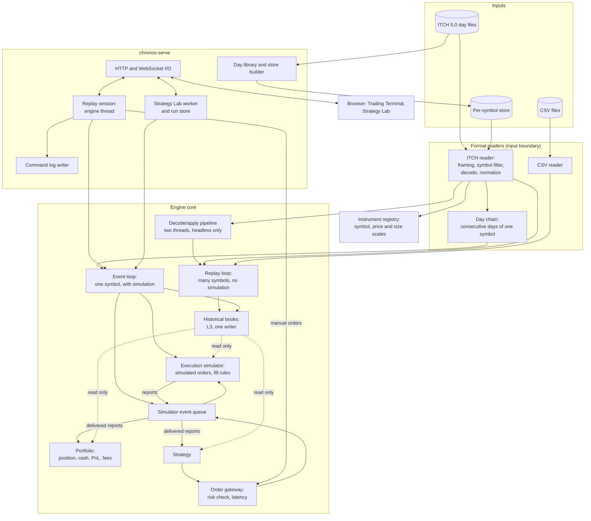
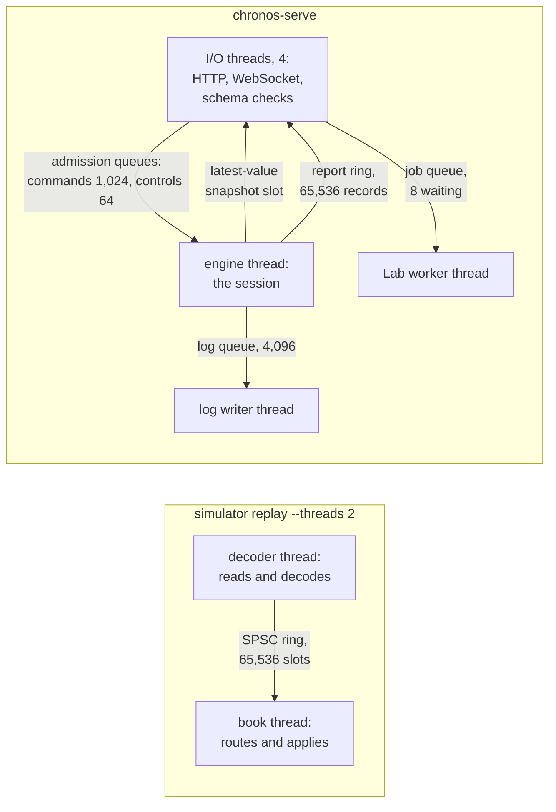

# System architecture

Chronos has three parts, each usable without the next:

1. **The engine:** a C++20 library and the `simulator` command line. It turns recorded feeds into market events,
   rebuilds historical books, and simulates strategies against them. Its library needs only the C++ standard library
   and POSIX; the per-symbol store's reader adds zstd and xxHash.
2. **The server:** `chronos-serve`, a separate executable built on the engine. It runs one interactive replay session
   on an engine thread of its own, runs Strategy Lab backtests on a worker thread, keeps the per-symbol store, and
   speaks HTTP and WebSocket.
3. **The browser UI:** the Trading Terminal and the Strategy Lab, served by `chronos-serve`.

Dependencies point one way: the UI knows only the server's protocol, the server knows the engine, and the engine knows
neither ([I8](README.md#the-invariants)).

## Components

Solid arrows carry events or orders; dotted arrows are read-only views of the historical book.

### Inputs and readers

| Component                     | Responsibility                                                                                                                                                                                                                                                               | Inputs                                                  | Outputs                                                     | Status                                                              |
| ----------------------------- | ---------------------------------------------------------------------------------------------------------------------------------------------------------------------------------------------------------------------------------------------------------------------------- | ------------------------------------------------------- | ----------------------------------------------------------- | ------------------------------------------------------------------- |
| **ITCH reader**         | Frames a day file, maps each message's stock locate to a symbol, skips unselected symbols' messages before decoding them, registers instruments from the stock directory, converts ITCH times to UTC epoch nanoseconds, and translates the order messages into market events | a memory-mapped day file, or one symbol's store segment | market events, one at a time, or an error with its position | **Verified**                                                  |
| **CSV reader**          | Reads market events from text, for the library and tests                                                                                                                                                                                                                     | a CSV file                                              | market events                                               | **Verified** by the conformance suite; not exposed in the CLI |
| **Test source**         | Replays an in-memory list of events                                                                                                                                                                                                                                          | a vector of events                                      | market events                                               | **Verified**                                                  |
| **Instrument registry** | Assigns each symbol a dense id and holds its price and quantity scales; readers write it, the book and portfolio read it                                                                                                                                                     | instrument directory entries                            | symbol ids and scales                                       | **Verified**                                                  |
| **Day chain**           | Plays several consecutive days of one symbol as one stream, with a day-boundary event between days, and reports its read position; used by the server                                                                                                                        | the days' store segments                                | market events                                               | **Implemented**                                               |
| **Per-symbol store**    | Holds one compressed file per symbol, with a segment for each day, so one symbol's day is read without reading the whole day file; checks every segment as it is read                                                                                                        | built once per day from the day file                    | one symbol's bytes for one day                              | **Verified** (hash-checked reads; crash-safe builds)          |

[market-data-and-replay.md](market-data-and-replay.md) describes the pipeline from bytes to events in full.

### The engine core

| Component                       | Responsibility                                                                                                                                                                                                                                                                      | Owns                                                                            | Depends on                                        | Status                                                                                        |
| ------------------------------- | ----------------------------------------------------------------------------------------------------------------------------------------------------------------------------------------------------------------------------------------------------------------------------------- | ------------------------------------------------------------------------------- | ------------------------------------------------- | --------------------------------------------------------------------------------------------- |
| **Historical book**       | The L3 book of one symbol: every resting order in FIFO order at its price, rebuilt by applying market events. Rejects an event that does not fit the book, leaving the book unchanged and naming why. Checks its own invariants on request and computes a digest of its state       | the symbol's orders and price levels, in storage reserved before the run        | the event contract                                | **Verified**                                                                            |
| **Book storage**          | Reserves every order, level and index slot a replay can use before it starts, shared by all books of a run                                                                                                                                                                          | fixed pools and open-addressing indices                                         | nothing                                           | **Verified** (0 allocations over the full day)                                          |
| **Replay loop**           | Pulls events from a source, checks their times never go backwards, routes each to its symbol's book, counts results, checks invariants periodically, optionally samples cost per event. Stops at a source error, an out-of-order time, an invariant violation or exhausted capacity | the run's counters                                                              | a source, the books                               | **Verified**                                                                            |
| **Decode/apply pipeline** | Runs the reader on a thread of its own and hands events to the replay loop through a single-producer single-consumer ring; the end of the stream and errors travel outside the ring                                                                                                 | the ring                                                                        | the reader                                        | **Verified**: the same books and digests as one thread                                  |
| **Event loop**            | Merges the market stream of one symbol with the simulator's own events in deterministic order, lets the execution simulator see each market event before the book applies it, then the portfolio and the strategy after. Step-wise, so a server can pace it                         | the generation's book, simulator, portfolio, strategy and simulator event queue | a source, the strategy                            | **Verified** (deterministic; worked-example tests)                                      |
| **Simulator event queue** | Holds the simulator's future events: order arrivals, cancel arrivals, report deliveries and timers, each at an exchange time                                                                                                                                                        | its events                                                                      | nothing                                           | **Verified**                                                                            |
| **Order gateway**         | The only way a strategy or a person sends an order: checks the risk limits, assigns the order id, and schedules its arrival one order latency later                                                                                                                                 | order ids                                                                       | the portfolio's limits, the simulator event queue | **Verified**                                                                            |
| **Execution simulator**   | Holds the simulated orders that rest, each with its place in the historical queue, and fills them by the fill rules as market events arrive; fills IOC orders against the visible book on arrival; emits execution reports                                                          | simulated orders and execution statistics                                       | read-only book                                    | **Verified** for its rules; realism open ([Q1](README.md#open-questions-and-known-gaps)) |
| **Portfolio**             | Books delivered reports: position, cash, realised and unrealised PnL (marked at the touch), fees and rebates, drawdown; enforces pre-trade risk limits; keeps a digest of every fill in order                                                                                       | the account                                                                     | read-only book, the instrument's scales           | **Verified**                                                                            |
| **Strategy**              | Decides what to send. Called on each applied market event, each report delivered to it, and each timer it set; gets a read-only book and portfolio, the gateway, and the trade the event printed                                                                                    | its own state                                                                   | the strategy boundary                             | **Implemented**: three built-in strategies                                              |

[event-and-execution-model.md](event-and-execution-model.md) describes how events and orders move through these.

### The server

| Component                        | Responsibility                                                                                                                                                                                                                                    | Status                                                      |
| -------------------------------- | ------------------------------------------------------------------------------------------------------------------------------------------------------------------------------------------------------------------------------------------------- | ----------------------------------------------------------- |
| **Day library**            | Finds the day files in the data directory, fingerprints each, builds each new day into the per-symbol store at start-up, and records each day's session hours from its own System Events                                                          | **Verified**                                          |
| **Replay session**         | Runs one interactive session on the engine thread: one generation (a symbol and its days) at a time, paced against the wall clock, with controls and commands applied at defined boundaries; publishes snapshots and records                      | **Verified**                                          |
| **Command log writer**     | Appends every command and its lifecycle to the session's log file on a thread of its own, so the session can be reproduced                                                                                                                        | **Verified** (a log reproduces its session's digests) |
| **Strategy Lab**           | Runs backtests and verifications on a worker thread, one at a time, with a bounded queue; saves each run with its provenance; cancels and deletes runs                                                                                            | **Verified**                                          |
| **HTTP and WebSocket I/O** | Serves the built UI and the API, checks every client message against its schema, admits commands and controls into the session, sends each connection the latest snapshot and the records it has not seen; enforces the local-tool security rules | **Verified**                                          |

[web-terminal.md](web-terminal.md) describes the session, its channels and its threads.

### The browser UI

A single-page app. It renders what the server publishes and sends commands; it holds no engine state of its own beyond
what it was sent ([web-terminal.md](web-terminal.md#the-browser)). **Verified** by end-to-end tests against a real
server.

## Executables

| Executable              | Contains                                                                                             | Links the server or UI?            |
| ----------------------- | ---------------------------------------------------------------------------------------------------- | ---------------------------------- |
| `simulator`           | `replay` (one, several or all symbols) and `backtest` (one symbol), from a day file or the store | no ([I8](README.md#the-invariants)) |
| `simulator_bench`     | micro-benchmarks of the engine's structures                                                          | no                                 |
| `chronos-serve`       | the engine, the server, the store builder; serves the built UI                                       | yes, by design                     |
| `chronos-e2e-fixture` | writes small generated day files for the end-to-end tests and the Docker sample                      | no                                 |

## Threads

| Thread                         | Owns                                                                      | Talks to others through                                                         |
| ------------------------------ | ------------------------------------------------------------------------- | ------------------------------------------------------------------------------- |
| CLI, one thread                | everything                                                                | nothing                                                                         |
| CLI decoder (with two threads) | the reader and the instrument registry                                    | the ring; end and error flags outside it                                        |
| CLI book thread                | the books and the replay counters                                         | the ring                                                                        |
| Server engine thread           | the session's book, simulator, portfolio, strategy, pacing clock, candles | admission queues (in), snapshot slot and report ring (out), the log queue (out) |
| Server I/O threads             | the connections and each connection's cursor                              | the admission queues, the snapshot slot, the report ring, the Lab's lock        |
| Server log writer              | the log file                                                              | the log queue                                                                   |
| Server Lab worker              | the running backtest (its own book, simulator and portfolio)              | the Lab's run table, under a lock; a cancel flag and a progress counter         |

No result depends on a clock. The engine core reads one only to sample the cost per event, when asked. In the
server, the engine thread reads it to pace the replay, the I/O threads for timeouts and rate limits, and the Lab worker
to time its runs for their provenance, outside the loop.

## Why the system is divided this way

- **Readers at the edge** let a new format arrive as one new reader, tested by the shared conformance suite, with no
  change to the book or the loops ([D4](decisions.md#d4-one-event-contract-and-one-book),
  [D5](decisions.md#d5-format-specific-readers-normalize-at-the-input-boundary)).
- **One writer for the history** makes "the simulation changed the past" impossible by construction rather than by
  discipline ([D1](decisions.md#d1-historical-reconstruction-and-simulated-execution-are-separate-paths)).
- **A step-wise event loop** gives the server a way to pace, pause and step the very same code the headless backtest
  runs, so there is one execution path to test ([D3](decisions.md#d3-one-deterministic-step-wise-event-loop)).
- **A separate server executable** keeps every network, JSON and UI dependency out of the engine and its benchmarks
  ([D9](decisions.md#d9-a-separate-chronos-serve-executable)).
- **One engine thread per session, with bounded channels,** keeps the engine's state single-threaded and its timing
  independent of clients ([D10](decisions.md#d10-the-engine-thread-owns-the-session-channels-are-bounded)).
