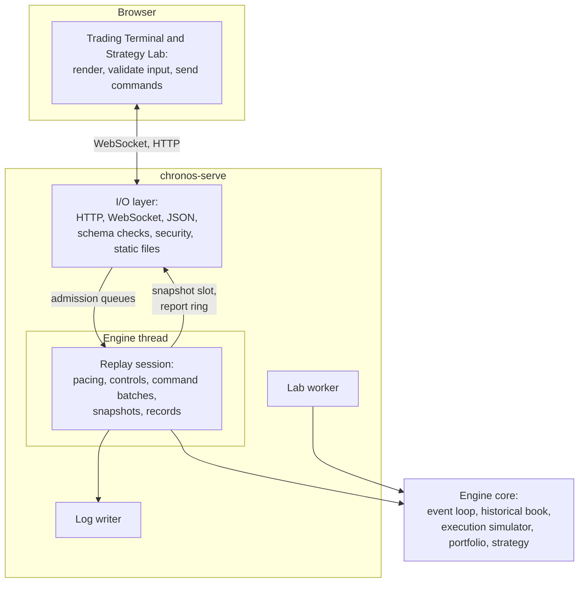
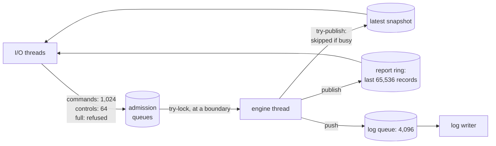

# The web terminal and its server

`chronos-serve` is a separate executable that puts the engine behind a browser. It is built so that the engine runs
the same code, in the same order, with or without it, and so that no client can slow or corrupt a replay. The
reference for its endpoints, messages and options is [server.md](../server.md); the pages are described in
[ui.md](../ui.md).

## Four layers

| Layer | Responsible for | Never does |
|---|---|---|
| **Browser UI** | showing the published state; the ticket's own checks; sending controls and orders | hold engine state beyond what it was sent; decide a fill |
| **Server I/O** | serving the built UI and the API; parsing and checking every message against its schema; admitting commands; sending each connection the latest snapshot and the records it has not seen; security | touch the engine's state directly |
| **Engine thread** | running one session: applying controls and command batches at boundaries, pacing the replay, building snapshots, publishing records | network I/O, JSON, or waiting on a client |
| **Engine core** | the event loop, book, simulator, portfolio and strategy, exactly as in a headless backtest | anything about sessions or time pacing |

## Isolation requirements

| Requirement | How it holds | Status |
|---|---|---|
| Headless replay, backtests and benchmarks depend on no browser, HTTP, WebSocket or UI code | the engine library includes and links none of it; the server is its own library and executable | **Verified**: CI's isolation check ([I8](README.md#the-invariants)) |
| No network I/O or JSON in the engine's processing path | the engine thread fills fixed binary structures; the I/O threads encode them | **Implemented** |
| The server never reads mutable engine state without a protocol | it reads only the published snapshot, under the slot's lock, and the report ring, under its lock; everything else stays on the engine thread | **Implemented** ([I7](README.md#the-invariants)); the server's tests run under ThreadSanitizer in CI |
| Commands enter through bounded queues and apply on the engine thread at defined boundaries | admission queues of 1,024 commands and 64 controls; applied in batches at boundaries ([below](#commands-and-controls)) | **Verified** by ordering tests |
| A slow or disconnected client never blocks the engine | the engine never waits on a client: it try-locks the admission queues and the snapshot slot, and its other shared locks are held only for bounded copies ([Q3](README.md#open-questions-and-known-gaps)); a lagging client loses snapshots, and records it falls too far behind on are replaced by a gap and a full state | **Verified**: a server test with a client that stops reading |
| Snapshot publication is safe under concurrent access | one latest-value slot; the engine skips a frame while a reader holds it; no buffer is read and written at once | **Implemented**; tested under ThreadSanitizer |
| Full queues, dropped snapshots, stale data, disconnects and invalid commands have defined outcomes | [the failure table](#defined-behaviour-under-failure) | **Verified** for each listed case |

Lock-free structures are an option, not what is used here. The server's channels are short critical sections behind
mutexes, try-locked by the engine where it must not wait. The only lock-free structure in Chronos is the headless
replay's single-producer single-consumer ring ([performance-and-determinism.md](performance-and-determinism.md)). A
lock-free triple buffer for snapshots, or a sequence-locked report ring, are recorded options if a measurement ever
shows the engine waiting.

## The channels

| Channel | Direction | Capacity | When full or busy | Status |
|---|---|---|---|---|
| **Commands** (orders, cancels, attach, detach) | I/O → engine | 1,024 | refused with `queue_full`; never dropped silently | **Verified** |
| **Controls** (play, pause, step, speed, seek, cancel seek, restart, load a symbol, watch) | I/O → engine | 64 | refused | **Verified** |
| **Snapshot** | engine → I/O | one latest value | the engine skips the frame and counts it in `dropped_snapshots`; readers always get the newest | **Verified** |
| **Report ring**: lifecycle steps, execution reports, control acks, generation marks, verdicts | engine → I/O | the last 65,536 records, numbered | a reader that falls behind gets a `gap` and a full state; the engine overwrites the oldest | **Verified**; the engine's publish takes locks that readers and admitting I/O threads also hold briefly ([Q3](README.md#open-questions-and-known-gaps)) |
| **Command log** | engine → writer thread | 4,096 records | above half full, the engine holds market work until the writer catches up; once the queue fills or a write fails, the log is failed and commands are refused with `log_unavailable` | **Verified** |

Every channel is allocated when the session starts, and none grows ([I9](README.md#the-invariants)). The chart's
history of closed one-second candles, kept for clients that reconnect, is reserved for every second of the
generation's days when it starts, about 4 MB a day.

## Commands and controls

A **command** changes simulated trading (an order, a cancel, attaching or detaching a strategy). A **control** changes
the replay (play, pause, step, speed, seek, restart, load, watch).

- **One admission point.** Every connection's messages pass through the session's admission, which numbers them
  (`command_seq`, `control_seq`) and refuses what cannot be accepted: a malformed message, a full queue, a failed log,
  a viewer, a stale generation, a state that cannot take commands.
- **Boundaries.** The engine applies pending controls first, then advances the replay, then applies pending commands
  as one batch, in order, at the session's current exchange time. Every simulator event a batch creates runs after the
  whole batch, even at zero latency. A boundary is identified by (market events applied, exchange time, batch number).
- **Latency applies to people too.** A manual order applied at exchange time `T` reaches the simulated exchange at
  `T` plus the order latency, as a strategy's order would.
- **Lifecycle.** Each command's steps (received, admitted or refused, applied or refused at apply, accepted or rejected
  by the simulator) are published as records and written to the command log, with the boundary at which each happened.
  A scripted replay of the log applies each command at its recorded boundary, so the session reproduces exactly,
  whatever the wall-clock timing was ([I5](README.md#the-invariants), [I11](README.md#the-invariants)).
- **Acknowledgement.** A command may apply once the log has queued its lines. The client's acknowledgement waits until
  its admitted line is written and flushed (and synced to the device with `--fsync`).

### Strategies and manual orders in a session

The session's event loop drives a **session strategy**: an adapter that holds either no strategy or one built-in
strategy, swapped at a command boundary. Manual orders do not go through the strategy interface; they go through the
same order gateway that strategies use, so they meet the same risk checks, latency and fill rules. While a strategy is
attached, manual orders are refused (one controller of the position at a time). The adapter also enforces an attached
strategy's trading window, each day's session hours by default.

| Capability | Status |
|---|---|
| Manual orders through the shared gateway | **Verified** |
| Attaching and detaching a built-in strategy over the protocol | **Implemented**; the page has no control for it |
| Replaying a Lab run's strategy in the terminal (Watch) to a reproduced-or-not verdict | **Verified** |

## Exchange time and wall-clock time

**Exchange time** is the time of the replayed market: it comes only from events, and it is what the engine, the
simulator, the latencies and every record use. **Wall-clock time** is the real time of the machine: only the engine
thread reads it to decide how far exchange time may advance (the I/O threads read it too, for timeouts and rate
limits), and it never reaches a result.

| Speed | Exchange time advances | Notes |
|---|---|---|
| 1× | one exchange nanosecond per wall nanosecond | the replay keeps real time |
| 10×, 100× | ten or a hundred times as fast | up to 1,000× through the API |
| Max | as fast as the engine runs | no pacing; the engine yields after a budget of 4,096 market events so controls stay responsive |

- **Pacing.** While playing, the target is the anchored exchange time plus elapsed wall time times the speed. Every
  market event at or before the target is applied; then exchange time moves to the target (never past the next market
  event), so simulator events due in a quiet period, an order's arrival say, happen on time and do not wait for the
  next market event.
- **Nights.** Over several days, the night between two days passes in no wall time.
- **Never mid-timestamp.** Play yields only between timestamps, so all events sharing a nanosecond apply together.

## Replay controls

| Control | Semantics | Commands during it |
|---|---|---|
| **Play** | paced replay at the chosen speed | applied at the current exchange time |
| **Pause** | exchange time freezes | accepted and applied at the frozen time; their arrivals wait until Play or Step moves time |
| **Step N** | applies N market events, then pauses | applied between steps |
| **Seek forward** | runs without pacing until the target time, sending progress; cancellable; no snapshots meanwhile | refused (`not_ready`) |
| **Seek backward** | a restart, then a forward seek: the replay is rebuilt from the start of its days to the target | refused (`not_ready`) |
| **Restart, load a symbol, watch** | a new **generation**: a fresh book, simulator, portfolio and strategy over the chosen symbol and days, paused before the first event | those stamped with the old generation are refused (`stale_generation`) |
| *(the replay has ended)* | the generation's stream is exhausted | refused (`not_ready`) |

**Generations.** Every message carries the session id and the generation. A command stamped with an earlier
generation is refused (`stale_generation`), so nothing from before a restart or a backward seek enters the new one.

**Determinism.** Seeking, pausing and stepping change only how much wall time passes, never the order of anything:
the same commands at the same boundaries give the same digests, at any speed, through any sequence of pauses and
steps. Backward seeking by restart-and-replay keeps that true without snapshots of past state. Checkpoints for an
instant backward seek are an option the protocol leaves room for; they are not built.

## Snapshots and records

- **Snapshots** are built by the engine thread between steps, so every field belongs to one instant: the exchange
  time, the state and speed, the top 20 levels a side, the market trades since the last snapshot (up to 512), the
  current and newly closed one-second candles, the account, our resting orders with their place in the queue, and
  metrics (events a second, dropped snapshots, commands drained, the log's health). At most 30 are published per
  wall second, whatever the speed. None are built while seeking (progress messages instead), and none at all in
  headless runs and backtests.
- **Candles** come from market trades only; simulated fills are drawn on them, never counted in them.
- **Records** in the report ring are numbered. A client keeps the number it has read up to; on reconnect it resyncs
  from there, or, if the ring has moved past it, gets a `gap` and a full state. The chart's history is refetched over
  HTTP for the current generation.

## Defined behaviour under failure

| Situation | Outcome |
|---|---|
| A client stops reading | the engine is unaffected; the client gets the newest snapshot when it reads; its records stay in the ring until overwritten, then it gets a `gap` and a full state. Its unsent frames accumulate in the server's send buffer, about 1 MB a second ([Q4](README.md#open-questions-and-known-gaps)) |
| A client disconnects | its connection is dropped; if it controlled the session, the next connection to authenticate takes control |
| A second tab connects | it is a viewer: it sees everything and is refused (`not_controller`) when it sends |
| A malformed message | refused (`bad_request`) |
| A WebSocket message or HTTP body over 64 KiB | the connection is closed |
| More than 50 commands a second from one connection | refused (`rate_limited`) |
| The command queue is full | refused (`queue_full`) |
| A command for an earlier generation | refused (`stale_generation`) |
| A command while seeking, or after the replay ended | refused (`not_ready`) |
| The log falls behind | market work waits for the writer; commands still admit |
| The log fails (its queue fills, or a write fails on a full disk) | commands refused (`log_unavailable`); the log reproduces the session up to the failure |
| The replay's source fails or a day is damaged | the generation ends, its snapshot naming the failure; the session stays up |
| The server stops | the session's log is closed with its final digests |

## Security

A local, single-user tool, still defensive: it binds the loopback address by default; any other address needs a
token for the API and the WebSocket; without a token, only loopback `Host` headers are answered (against DNS
rebinding); a WebSocket must come from the page this server served; state-changing requests must be JSON from that
origin. Details in [server.md](../server.md#security). Availability is not guarded: anything public needs a buffering
reverse proxy in front.

## The browser

The page is a React single-page app with one charting dependency. It keeps a store of what the server sent, updates
the screen at most once a frame, and never computes a fill or a position itself.

| Capability | Status |
|---|---|
| Price chart: one-second candles at several timeframes, VWAP, EMA, volume, session shading, our orders and fills | **Implemented**: candles, VWAP, EMA and fill marks unit-tested; no end-to-end test reads the chart |
| Depth ladder with our queue position | **Verified** |
| Time and sales | **Verified** |
| Order ticket (post-only, IOC, market) with its own checks | **Verified** |
| Positions, PnL and its curve | **Verified**; the fills list and the curve start empty after a reload ([limitations.md](../limitations.md#what-the-server-assumes)) |
| Symbol selection over one or more days | **Verified** |
| Play, pause, step, speed, seek, restart | **Verified** |
| Strategy-driven simulation in the terminal | **Partial**: Watch replays a Lab run; no attach control on the page |
| Strategy Lab: run, compare, verify, export, watch | **Verified** |
| An engine strip: events a second, dropped snapshots, commands drained, the configured latencies, the session's state | **Implemented** |
| A symbol browser and a fuller engine monitor | **Planned** (UI-3, not yet specified); a ranked symbol picker exists |
| One session with several symbols, several users | **Out of scope** |
