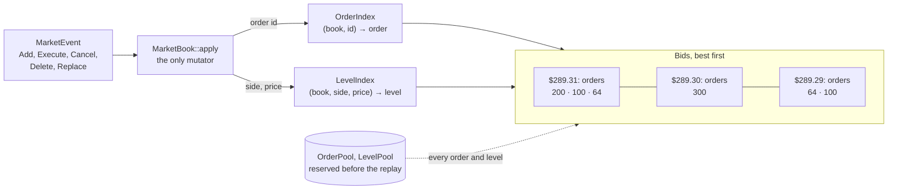

# The L3 order book

`MarketBook` is the historical book of one symbol, rebuilt order by order from market events. `MarketBooks` holds one
per symbol for a multi-symbol replay, every book sharing one `BookStorage`.

## Applying an event

`MarketBook::apply(event)` is the book's only mutator. It returns an `ApplyResult`, and every rejection leaves the book
unchanged:

| Result | When |
|---|---|
| `Applied` | the event changed the book; Trade and Status events apply without touching an order |
| `WrongSymbol` | the event is another symbol's |
| `UnknownOrder` | an Execute, Cancel, Delete or Replace of an id not in the book |
| `DuplicateOrder` | an Add, or a Replace's new id, already in the book |
| `ZeroQuantity` | an Add, Execute, Cancel or Replace of 0 shares |
| `ExceedsRemaining` | an Execute or Cancel of more than the order's remaining |
| `InvalidReplace` | a Replace whose new id is its old one |
| `CapacityExhausted` | an Add or Replace that a full pool or index has no room for; `exhausted()` names it, and the replay stops |
| `Unsupported` | a Modify, which no current source emits |

A decoder or book bug, a skipped `F` or `C` message, a wrong field offset or a wrong replace, typically shows up as
`UnknownOrder` or `ExceedsRemaining`. On NASDAQ's full day of 2019-12-30 the count is 0 for every symbol.

Each order keeps a sequence number, so its place in its level's FIFO queue is exact. That queue is what the fill model
reads to know how many historical shares stand ahead of a simulated order ([backtesting.md](backtesting.md)).

**Trading status.** ITCH `H` messages become Status events. A book that is not trading (halted, paused or quotation
only) may cross until trading resumes; the crossed check skips it.

## Storage: nothing allocates during a replay

`BookStorage` reserves everything the books of one replay share before the replay starts, from `--capacity` C:

| Structure | Holds | Notes |
|---|---|---|
| `OrderPool` | C `Order`s | a free list over a fixed array |
| `OrderIndex` | (book, `OrderId`) → `Order*` | open addressing, one table for every book: `MarketEvent` promises an id unique only within its symbol, so the book is part of the key |
| `LevelPool` | C `PriceLevel`s | every live level holds a live order, so C is enough |
| `LevelIndex` | (book, side, price) → level | open addressing, one table for every book |
| ladder windows | 256 slots per side per book | the ladder backend only |

A full structure stops the replay as `CapacityExhausted` rather than growing. The full day, every symbol, peaks at
1,924,078 live orders; the `--all` default capacity is 4,194,304.

## Price levels: a list, or a ladder a cent apart

Each side of a book is a doubly linked list of levels, best first, found through the level index. That is the `list`
backend. Finding an existing level is one hash lookup; placing a **new** level is the cost: it has to find its
neighbours.

The `ladder` backend, the default, keeps the list and the index and adds, per side, a window of 256 slots a cent
apart (`ladder_step(price_scale)`: 100 price units at ITCH's four decimals, 1 at two or fewer):

- A price on the cent grid inside the window has a slot. A new level there is linked after the nearest set slot towards
  the best: a short scan of the window instead of a walk of the list.
- A price off the grid, or outside the window, is placed by the list's walk, as the list backend does.
- When the best leaves the window's middle half, the window recentres so the best's grid price sits in its middle,
  and refills its slots from the list.

Before the ladder's slots were a cent apart they were one price unit apart: 256 units are $0.0256 in ITCH prices, about
one cent level per side, so most new levels missed the window. With a cent step, ladder × 2 became the fastest
configuration ([performance.md](performance.md)). Placing a new level is still the largest cost, 40 % of the book
thread's time in the profile: the candidate next step, noted in the code, is a bitmap of the slots set, so the scan
reads a few words.

`OrderBook` reads its backend from its storage at run time. `BasicOrderBook<List>` and `BasicOrderBook<Ladder>` fix it
at compile time, which only the benchmark that prices the run-time dispatch uses (it costs about 1 ns an operation).

## Invariants

`check_invariants()` returns the first broken invariant, or `None`:

| Invariant | Broken when |
|---|---|
| `IndexWithoutLevel` | an indexed order is not linked into a level, or is under the wrong one |
| `LevelWithoutIndex` | a linked order the order index does not map to itself |
| `LevelTotalMismatch` | a level's total is not the sum of its orders' remaining |
| `EmptyLevel` | a level with no order |
| `SequenceNotIncreasing` | FIFO broken: sequence numbers must rise from head to tail |
| `InactiveOrderInBook` | an order not Active or PartiallyFilled, or with nothing remaining |
| `PoolCountMismatch`, `LevelCountMismatch` | the pools' slots in use or the indices' sizes disagree with the live orders and levels of all books |
| `CrossedInRth` | best bid above best ask during regular trading hours, while the book is trading |
| `LevelOutOfOrder` | a side's list is not strictly best first, or its links disagree |
| `LevelNotIndexed` | the level index does not map a level's price to it |
| `WindowMismatch` | a ladder slot and the level at its price disagree, or the best is off-centre |

The CLI checks every book at the end of a run and, with `--check-invariants N`, the book the N-th applied event
changed, every N events; the tests check after every operation. The correctness runs passed 258,271 such periodic
checks on the full day in each configuration, then every book at the end.

## Digests

A book's digest is FNV-1a 64 over its state, mixed byte by byte little-endian so it does not depend on the host.
`MarketBooks::digest()` combines (symbol id, last sequence, book digest) over every book in `SymbolId` order; the last
sequence keeps a book that ends the day empty from hashing like an unused one. The full day's combined digest,
`6897f945bcef75c2`, is the same in every configuration, one thread or two, list or ladder, and in the previous engine.

With every book empty at the end of the day, the digest fingerprints each symbol's count of Adds and Replaces. It is a
regression check across code changes, not a proof of correctness; the invariants and the 0 rejections carry that.

## Tests

- `MarketBookTest.RandomStreamKeepsInvariantsAndIsDeterministic`: 10,000 seeded random events of every type but
  Status, valid and invalid. The invariants hold after every event, a rejected event never changes the digest, and
  two runs end with the same digest.
- `BookModelTest`: a randomised operation stream applied to the list, to the ladder at steps 1 and 4, and to a plain
  `std::map` reference model gives the same book after every operation.
- `LadderTest`: every window transition (each edge, recentring, jumps, recycled levels, a refilled side, levels off the
  grid between levels on it), at a step of 1 and of 100.
- Exhaustion tests in `MarketBookTest` and `MarketReplayTest` fill each pool and index to its limit and check the
  clean `CapacityExhausted`.
