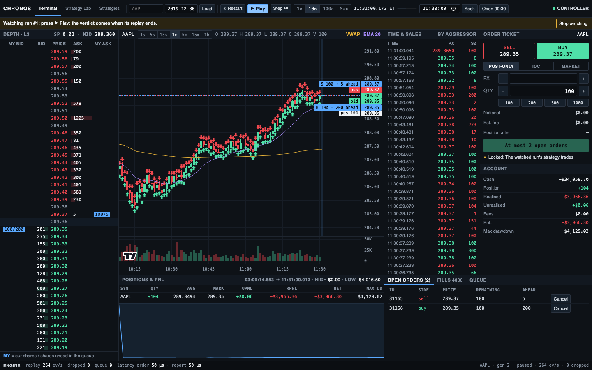
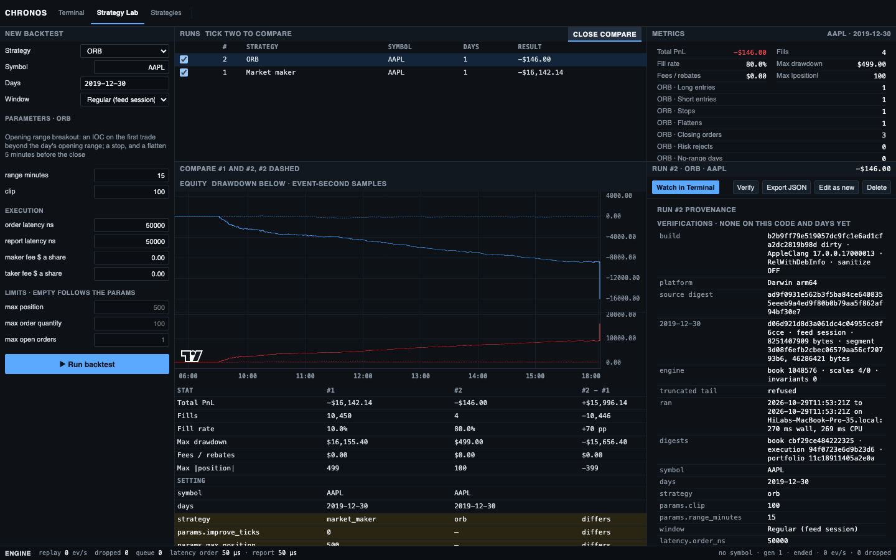

# The Trading Terminal, the Strategy Lab and the Strategies page

A React 19 and TypeScript single-page app in [`web/`](../web/), served by `chronos-serve`. Its only runtime dependencies
are React and TradingView's lightweight-charts.

```bash
(cd web && npm ci && npm run build)            # writes web/dist; needs Node 24
./build/chronos-serve --data data/itch         # open http://127.0.0.1:8080/
```

## The Trading Terminal



Type a symbol such as `AAPL` in the top bar and press Enter: the replay waits, paused, before the symbol's first event.
The page is a grid of square panels, every number in a monospace face:

- **Top bar.** The symbol and its days, Load, Restart, Play or Pause, Step, the speed (1×, 10×, 100× or Max), the
  exchange clock and how much of the day is read, Seek (to a New York time, or the 09:30 open), and the connection.
  The symbol box lists the days' symbols as you type: the one typed first, then those it starts, then those it is
  inside, plain tickers before preferreds and warrants; the arrows and Enter, or a click, load one. To replay a symbol
  over several days in a row, tick them in the day list: each night passes at once, and Seek then takes a day and a
  time. With the box empty, Load reloads the symbol on the days ticked.
- **Depth ladder** (left, full height). The L3 book as a price ladder a cent a row (a sub-penny level under $1 is a
  row of its own), the spread in the middle: the book's size at each price with a depth bar, and our resting orders as
  our shares over the shares still ahead of them in the queue. Click a row to price the ticket.
- **Chart.** 1 s candles from the market's own trades, at 1 s to 1 h timeframes, with VWAP, EMA 20 and volume; pre- and
  post-market and halts shaded; the best bid and ask, our resting orders (with the shares ahead of each) and our
  position's average price as price lines; and our fills as one arrow per candle and side, their shares summed.
- **Positions and PnL** (under the chart). The position with its average, mark, unrealised, realised and net PnL and
  max drawdown, over the net PnL from its first change, one sample a second, as this page saw it.
- **Time and sales.** The market's trades, coloured by the aggressor.
- **Ticket.** The side, each button showing the price it would meet (the bid or the ask); post-only, IOC or market; the
  price a tick at a time and the quantity by 100 or a preset; the notional, the estimated fee or rebate and the position
  after. Orders go through the same `ExecutionSimulator` as the backtests
  ([backtesting.md](backtesting.md#d2-the-fill-model)); paused, an order reaches the book on the next Step or Play.
  While a Lab run is watched the ticket is locked and says why.
- **Account**, and under the ticket and the tape, **open orders** (with cancel), **fills** (with the rule that filled
  each and its queue ahead at entry) and each resting order's **queue** position.
- **Engine strip** (bottom, on both pages). The replay's events a second, the snapshots this page skipped, the commands
  the session drained, the simulated order and report latencies, and the session's symbol, generation and state.

## The Strategy Lab



At `http://127.0.0.1:8080/#lab`, or through the switch in the top bar:

- **New backtest** (left): the strategy and its params, the symbol, the days (a day whose regular hours are the
  09:30-16:00 fallback is marked), the window, latencies, fees in dollars a share, and limits. The defaults and caps
  are the server's; a value past its cap, or one the server refuses, is marked, and a symbol a day does not list names
  the day. Strategies written in the browser are listed with the plugins, as "<name> (script)", their summary under
  the parameters.
- **Runs** (top middle): each run's state, progress or PnL. Tick two to **Compare**.
- **Results** (middle): the PnL at every second with a market event and its drawdown below; the fills with their rule
  and queue ahead at entry; the fill attribution; PnL by hour and, over several days, by day; for a script that logged,
  its log. Comparing, the two runs'
  PnL overlaid, lined up by day and time of day, their stats side by side, every setting that differs marked, and runs
  over another symbol or other days flagged.
- **Metrics** (top right): total PnL, fills, fill rate, max drawdown, fees and rebates, max |position|, then the
  strategy's own stats, each named after it (the ORB's entries, closing orders, range and shares, say). A failed or
  cancelled run's figures are marked partial.
- **The run picked** (right): **Watch in Terminal**, **Verify**, **Export JSON**, **Edit as new**, **Cancel** and
  **Delete**, and its provenance: the build, each day's hash, session source and size, the engine, the timings, the
  digests and every verification.

**Watch in Terminal** replays the run in the terminal, paced, at any speed, with the run's own fees and limits on the
ticket, and says when the replay ends whether it reproduced. **Stop watching** loads the plain replay of the same symbol
and days.

## The Strategies page

At `http://127.0.0.1:8080/#strategies`: strategies written in the browser as Lua scripts
([strategies.md](strategies.md#a-strategy-written-in-the-browser)).

- **Strategies** (left): every saved script, marked ok or error, and a name box to start a new one from a template that
  runs.
- **Editor** (middle): the script, with Save (Cmd/Ctrl+S) and Delete (asked twice). Tab indents. Save keeps the script
  even if it does not load, then shows under the editor its params and limits, or its error and the line. A script
  that loads is offered in the Strategy Lab's list as "<name> (script)".
- **Guidelines** (right): what to know before writing or testing a strategy, and every call a script can make.

## How the page is built

- **One store per page**, outside React ([`store.ts`](../web/src/store.ts), [`lab.ts`](../web/src/lab.ts)). Each panel
  subscribes to its own slice through `useSyncExternalStore` with a selector that returns a stable reference, so a
  snapshot re-renders only the panels whose data changed.
- **A pure reducer.** `apply(state, message)` folds each WebSocket message into the state; the tests drive it with plain
  messages, no browser.
- **Once a frame.** The store applies every message as it arrives but tells its listeners at most once per animation
  frame. A run watched at Max sends about 14,000 messages a second, and the screen shows 60.
- **The chart draws incrementally**: a new generation or a history fetch sets the series' data once; after that each
  snapshot redraws only the last bucket and appends new ones.
- **Reconnects** resync reports from the last seq the page applied. A new state refetches the generation's history;
  a skipped or truncated snapshot refetches only from the last closed candle.
- **Pure layout logic.** The depth ladder's rows ([`ladder.ts`](../web/src/ladder.ts)) and the chart's buckets,
  indicators and fill marks ([`candles.ts`](../web/src/candles.ts)) are pure functions with their own Vitest tests.
- **Nothing from outside.** The page loads only what `chronos-serve` serves: system fonts, no CDN.

## Developing

Vite serves `web/src` with hot reload. It proxies `/api` and `/ws` to `chronos-serve` and rewrites `Host` to
`127.0.0.1:<port>`, and the `Origin` of the WebSocket and of the Lab's POSTs and DELETEs too when the page itself is on
`localhost` or `127.0.0.1`: without a token, that is all `chronos-serve` accepts.

```bash
./build/chronos-serve --data data/itch --date 2019-12-30 --port 8080
(cd web && CHRONOS_PORT=8080 npm run dev)      # http://localhost:5173/
```

## Tests

From `web/`:

```bash
npm run typecheck && npm test                  # Vitest: the stores, candles, order checks, the Lab and formatting
npx playwright install chromium                # once
npm run e2e                                    # builds web/dist, then Playwright against the build's two binaries
```

Each end-to-end test starts its own `chronos-serve` on small generated days, which `chronos-e2e-fixture` writes to a
temp directory. They place an order and see it fill; drop the WebSocket in the middle of a restart and check that the
terminal ends on the new generation and sends nothing stale; seek to a New York time; play across a night; connect to a
server that wants a token; run, compare, verify, export and delete Lab runs; watch a run to its verdict; and edit a day
file under a run to see Verify and Watch refuse a changed input but accept another symbol's change.

## Measuring the page

Two Playwright specs measure instead of asserting, and run only when given a day file:

```bash
CHRONOS_BENCH_FILE=../data/itch/12302019.NASDAQ_ITCH50.bin npx playwright test bench   # the server at Max, trading
CHRONOS_LAG_FILE=../data/itch/12302019.NASDAQ_ITCH50.bin npx playwright test lag       # where the page's time goes
```

`lag` plays a symbol at each speed, switches to the Lab and back while it plays, then runs the default strategy and
watches it at Max. For each window it prints the WebSocket messages and bytes a second, the time the socket's handler
took, the long tasks and the frame gaps. `CHRONOS_*_SYMBOL`, `_DATE`, `_STORE` and `_OUT` set the symbol, the day, a
store to reuse and a file for the JSON summary.

On 2026-10-27, AAPL with the market maker:

| Window | Before | Once a frame | Dense Pro |
|---|---|---|---|
| watching the run at Max: socket handler's share of the main thread | 66.7 % | 1.9 % | 1.8 % |
| frames a second | 30.8 | 59.7 | 60.0 |
| frames over 50 ms | 41 | 0 | 0 |
| worst frame | 117 ms | 50 ms | 17 ms |
| switching to the Lab while playing | one 96 ms task | none | none |

Watching the run used to tell every listener of every message, and the chart then redrew every fill marker (a CPU
profile put 51 % of the page's time in its `setMarkers`); switching to the Lab added the symbol list's 8,906 options
one by one to a mounted list. The store now notifies once a frame, and the list mounts whole. The Dense Pro layout
then draws a run's fills as one marker per candle and side, which takes the worst frame to 17 ms. One frame of about
67 ms remains when a finished run's results first draw (its equity curve, up to 57,600 samples a series).
